# Lockstep

**Compare, inspect and sync KV secrets across HashiCorp Vault clusters.**

[](https://github.com/welshstew/lockstep/actions/workflows/security.yml)
[](https://github.com/welshstew/lockstep/actions/workflows/e2e.yml)
[](LICENSE)

**Try it:** [demo.getlockstep.cloud](https://demo.getlockstep.cloud), a public demo with two throwaway Vaults (sign in as `alice` / `password`; data resets every hour).

Compare **KV v2 secrets engines** across HashiCorp Vault clusters, or across two mounts in the same Vault. See exactly which values differ, without displaying them. Copy selected keys between the two sides safely, with a reviewed changeset.

<picture>
  <source media="(prefers-color-scheme: dark)" srcset="docs/images/02-compare-dark.png">
  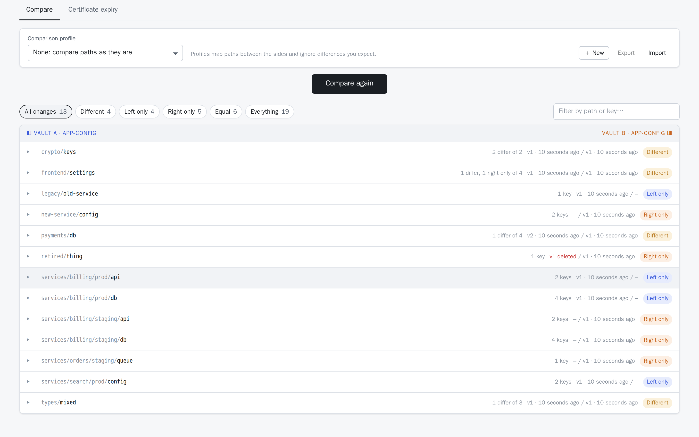
</picture>

## Features

- **Compare anything to anything.** Two Vaults, two mounts, or two path prefixes. Each side has its own connection, mount and prefix.
- **Values are compared on the server and never shown unless you ask.** The browser receives only a status per key (equal / different / left only / right only / no access). **Show values** reveals them, only for the secrets you open.
- **Only values count.** Versions, timestamps and the order of keys inside JSON are ignored. `5432` vs `"5432"` is flagged as a *type* difference.
- **Comparison profiles.** Pair paths that differ between environments (`services/*/prod/**` ⇄ `services/*/staging/**`), and ignore keys or paths that are meant to differ. Copies follow the mapping. Profiles can be shared by the team (server) or personal (browser, export/import).
- **Honest about permissions.** Secrets you can't list or read show as **No access**, never as "only on the other side", so nobody overwrites what they couldn't see.
- **Copy with ← / →** per key or per secret. A review shows exactly what each target gets. Writes use KV v2 **check-and-set**: a target changed by someone else since you compared becomes a conflict, not an overwrite. Nothing is ever deleted. Every write is **audit-logged** (without values).
- **Sync plans.** Save a reviewed set of copies as a signed file (paths, keys and versions, never values) that doubles as a report of what needs updating from where. Someone with write access opens it, checks it and applies it. If anything in it changed since it was made, nothing is written and the plan has to be made again. Read-only users can prepare plans.
- **Certificate expiry dashboard.** Scan one or both sides' mounts for every certificate (PEM, DER, base64, PKCS#12, JKS/JCEKS; keystores opened with the password stored beside them) and see what expires when. Only certificate details come back, never values.
- **Value tools.** Each value is identified by its content: base64, PEM, DER, **X.509 certificates and chains** (validated link by link), **PKCS#12**, **JKS / JCEKS** keystores, keys, CSRs, images, ZIP/JAR, PDF… Inspect one or both sides, compare certificates field by field, preview images, download files.
- **Last-updated metadata.** When each secret was written and when each key last changed (worked out from KV v2 versions), never part of the comparison.
- **Sign in your way.** Token, userpass, LDAP, **OIDC redirect** (the same flow as the Vault UI), or the pod's **Kubernetes service account** with a mount and role you choose.
- **Built to run on Kubernetes.** Stateless (sessions live in an encrypted cookie), configured only through environment variables, runs on **Red Hat Hardened Images** (distroless, non-root), scanned in CI.

## Screenshots

| | |
|---|---|
| **Connect.** Each side discovers the login methods its Vault offers (OIDC preselected).<br><picture><source media="(prefers-color-scheme: dark)" srcset="docs/images/01-connect-dark.png">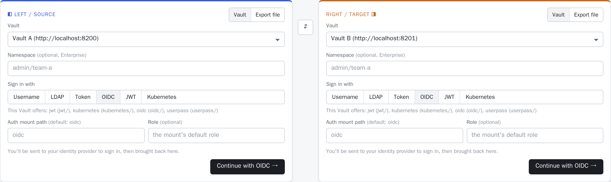</picture> | **Key detail and copying.** Values shown on request, per-key last change, a staged copy (→) with the target value outlined.<br><picture><source media="(prefers-color-scheme: dark)" srcset="docs/images/03-detail-and-copy-dark.png">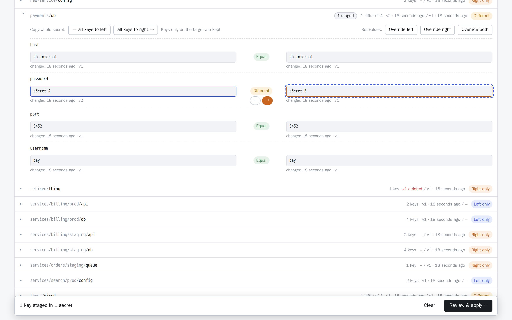</picture> |
| **Review before writing.** Per target secret: keys added or updated, version change, permission and conflict checks.<br><picture><source media="(prefers-color-scheme: dark)" srcset="docs/images/04-review-dark.png">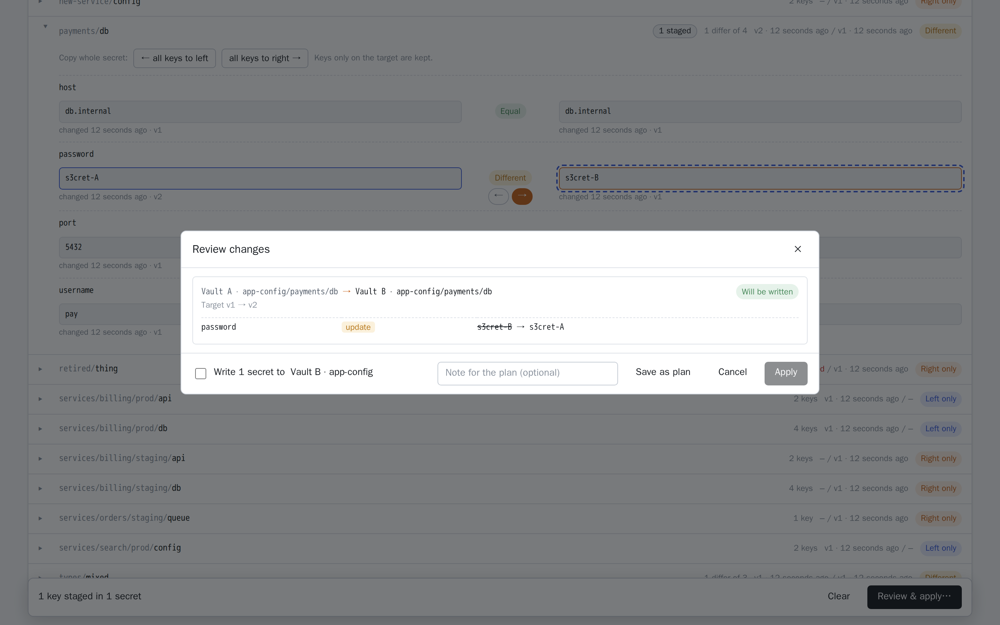</picture> | **What each value is**, even while masked: keystores, certificates, expiry.<br><picture><source media="(prefers-color-scheme: dark)" srcset="docs/images/05-badges-dark.png">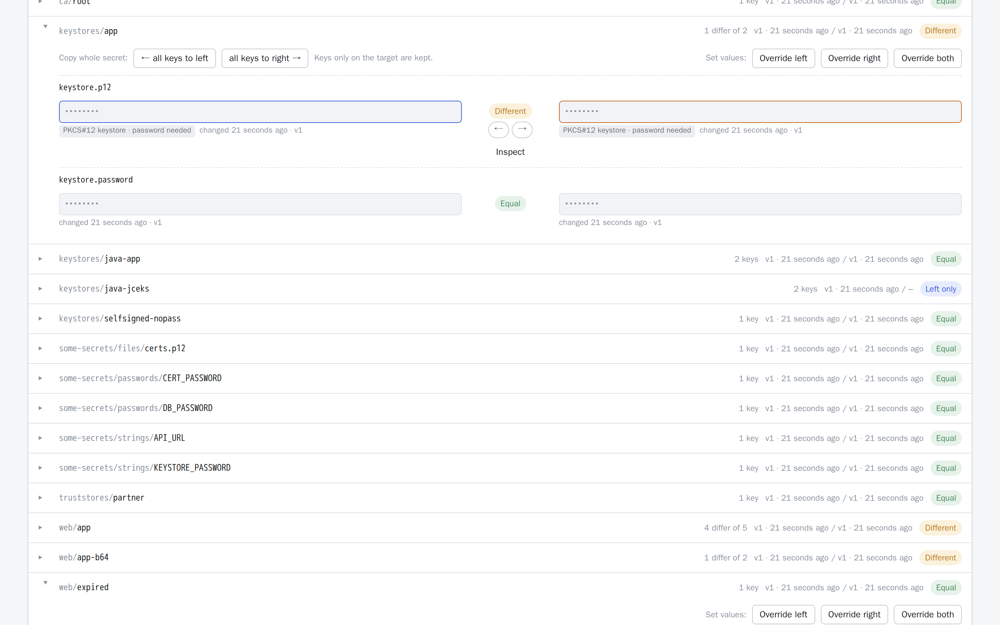</picture> |
| **Comparison profiles.** Map `prod` paths to `staging` paths, ignore keys meant to differ (here `host`); copies follow the mapping.<br><picture><source media="(prefers-color-scheme: dark)" srcset="docs/images/09-profile-dark.png">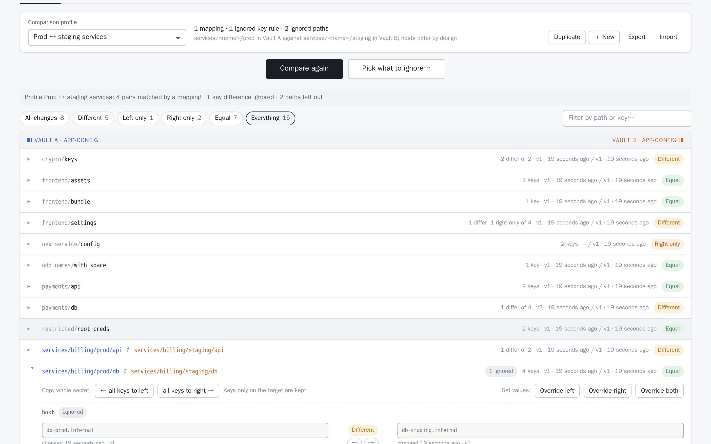</picture> | **Profile editor.** Mappings with wildcards, ignored keys and paths. Shared profiles come from the server; personal ones live in your browser and export as JSON.<br><picture><source media="(prefers-color-scheme: dark)" srcset="docs/images/10-profile-editor-dark.png">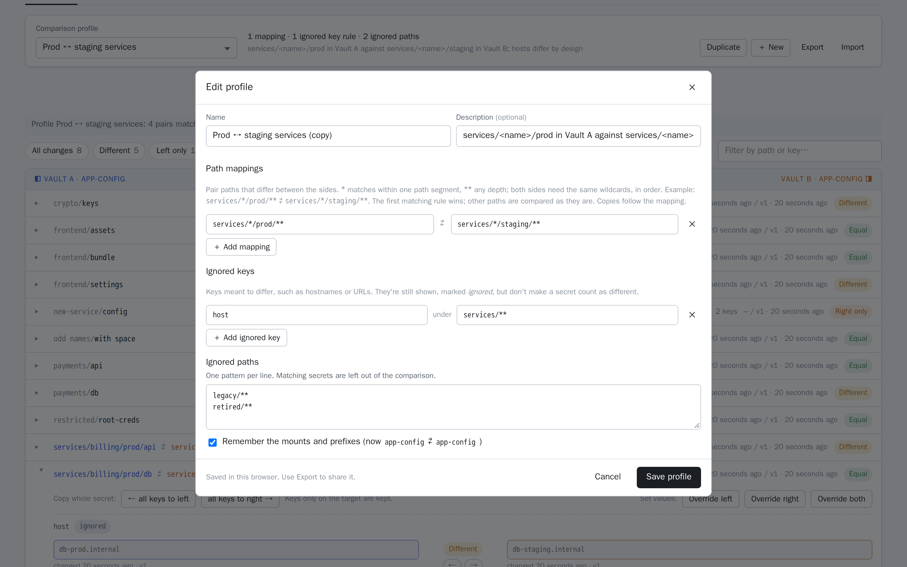</picture> |
| **Inspect both sides.** A PKCS#12 opened with its sibling password key; certificates compared field by field.<br><picture><source media="(prefers-color-scheme: dark)" srcset="docs/images/06-inspect-pkcs12-dark.png">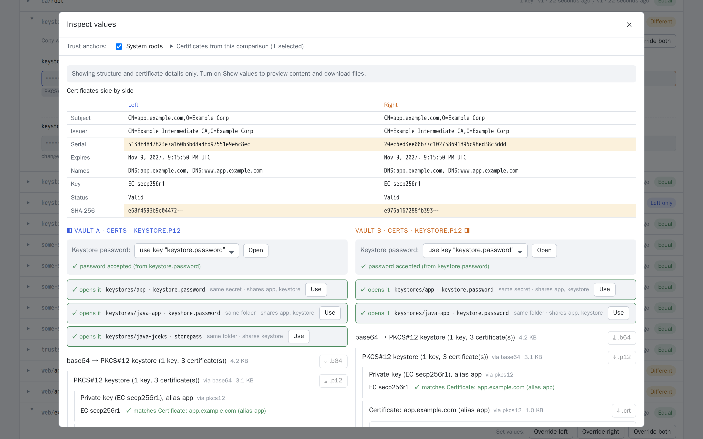</picture> | **Certificate chains**, validated link by link against the trust anchors you choose.<br><picture><source media="(prefers-color-scheme: dark)" srcset="docs/images/07-certificate-chain-dark.png">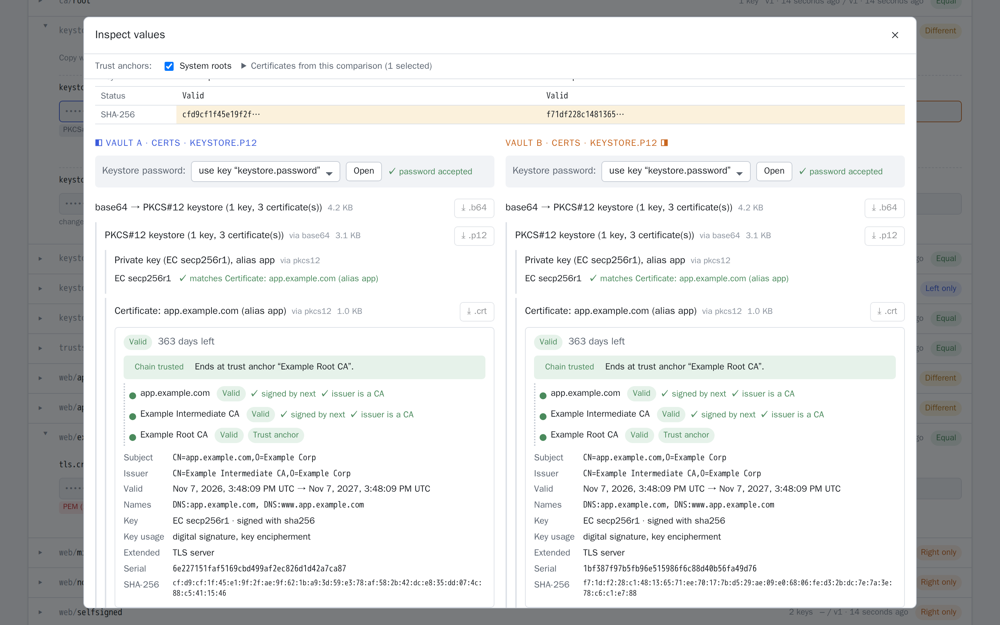</picture> |
| **Certificate expiry dashboard.** Every certificate in both mounts, including inside keystores, by time to expiry; filter, inspect, export CSV.<br><picture><source media="(prefers-color-scheme: dark)" srcset="docs/images/11-expiry-dark.png">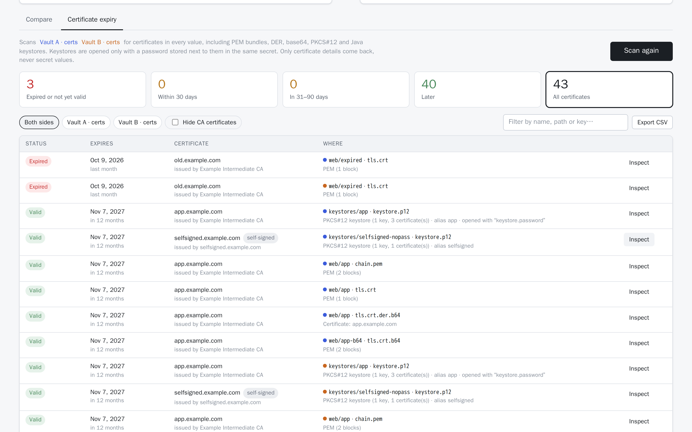</picture> | **Sync plans.** A saved plan, opened and checked against both Vaults before anyone applies it.<br><picture><source media="(prefers-color-scheme: dark)" srcset="docs/images/12-sync-plan-dark.png">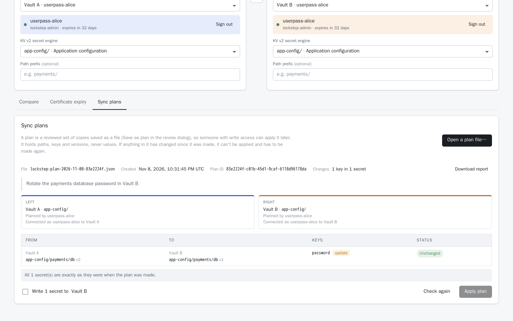</picture> |

## Quick start (local, with two demo Vaults)

Requires Podman (or Docker) with Compose.

```sh
make up          # = podman compose up --build -d
open http://localhost:8080
```

This starts two dev-mode Vaults filled with demo data, Dex as an OIDC provider, and the tool. Sign in with **OIDC** as `alice@example.com` / `password`, or with **Username** `alice` / `password`, on both sides. Pick `app-config` on each side and press **Compare**. The [development guide](docs/development.md) lists every demo user, mount and fixture.

`make up-k8s` also starts a small **k3s** cluster, so you can try [Kubernetes auth](docs/authentication.md#kubernetes-service-account) locally.

## Deploy

```sh
helm upgrade --install lockstep ./charts/lockstep -n lockstep --create-namespace -f my-values.yaml
```

A hardened chart: non-root, read-only filesystem, a session key kept across upgrades, optional Ingress, NetworkPolicy and Kubernetes auth. See [Deploying on Kubernetes](docs/kubernetes.md) and the [chart README](charts/lockstep/README.md).

## Documentation

| Guide | Contents |
|---|---|
| [Using the tool](docs/usage.md) | Comparing, statuses and permissions, copying values, value tools, timestamps |
| [Authentication](docs/authentication.md) | Token, userpass/LDAP, OIDC redirect, **Kubernetes service account**: app settings *and* the Vault-side setup for each |
| [Configuration](docs/configuration.md) | Every `LOCKSTEP_*` setting |
| [Deploying on Kubernetes](docs/kubernetes.md) | The Helm chart, a deployment checklist, OIDC callback and Kubernetes auth in a cluster ([chart values](charts/lockstep/README.md)) |
| [Public demo](docs/demo.md) | Run the self-contained demo stack on a Docker host with Caddy and automatic HTTPS |
| [Security model](docs/security.md) | What the tool sees, stores, logs and writes; hardening and supply chain |
| [Development](docs/development.md) | Project layout, demo data, tests, k3s profile, screenshots, security scanning, CI |
| [API](docs/api.md) | HTTP endpoints |

## Status and roadmap

**Working:** comparison, copying, value tools, last-updated metadata, comparison profiles (path mapping and ignore rules), a certificate expiry dashboard, all sign-in methods (token, userpass/LDAP, OIDC redirect, Kubernetes), a Helm chart tested in a real cluster, and in CI security scanning, chart checks and browser end-to-end tests.

**Possible next steps:**
1. **Four-eyes rule for sync plans:** optionally require the person applying a plan to be someone other than its creator (plans already record who made them)

## Licence

[MIT](LICENSE). Third-party components keep their own licences; see [NOTICE](NOTICE).

Contributions are welcome ([CONTRIBUTING.md](CONTRIBUTING.md)). Please report security issues privately ([SECURITY.md](SECURITY.md)).

---

*Lockstep is an independent project. It is not affiliated with, endorsed by or sponsored by HashiCorp. HashiCorp and Vault are trademarks of HashiCorp, Inc.*
