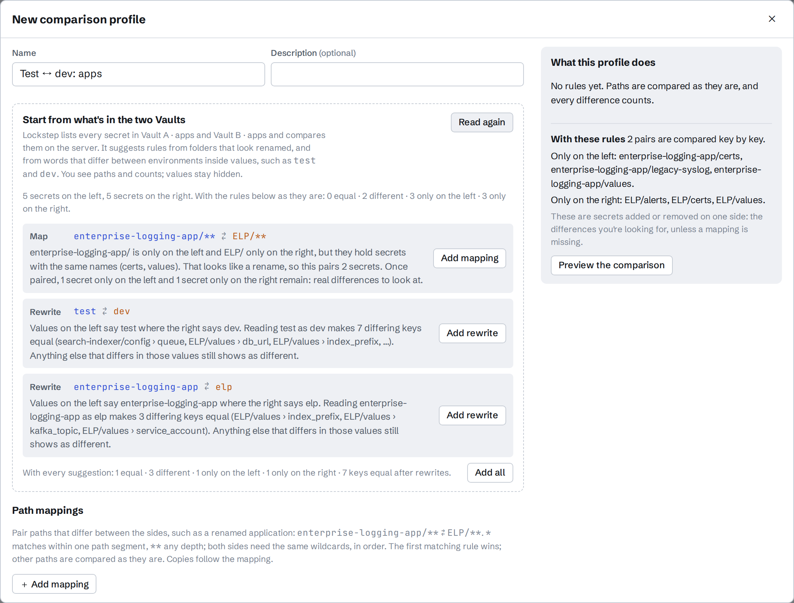
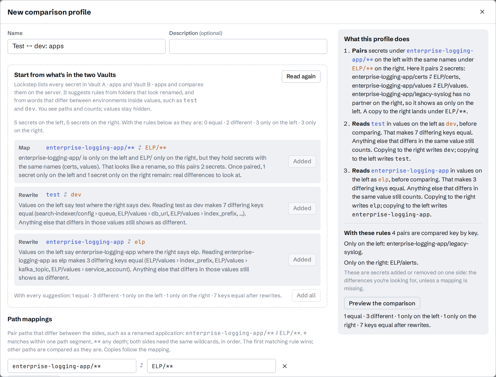
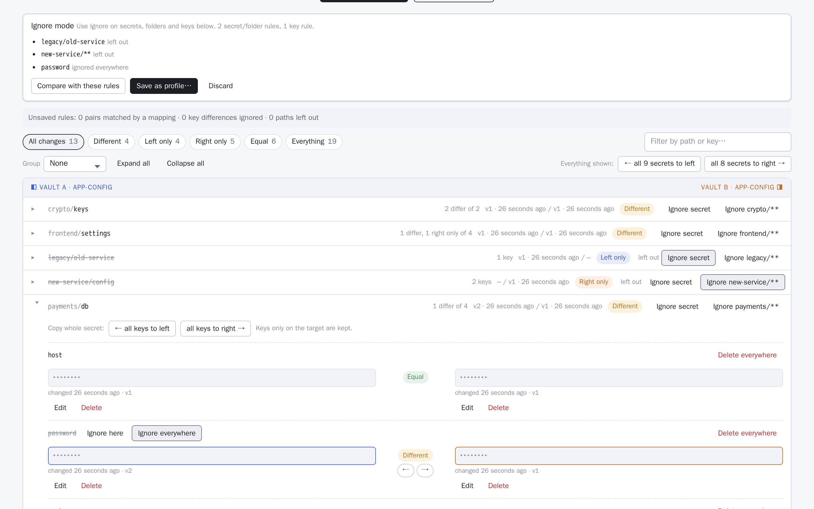

<!-- description: Stop expected differences between HashiCorp Vault or OpenBao environments from drowning out real drift: let Lockstep read both sides and suggest a comparison profile, add what to ignore, and reuse it in the UI, the CLI and CI. -->
# Building a comparison profile

Two environments that "match" never match exactly. Staging keeps its secrets under `staging/` where production uses `prod/`. Values name their environment: `db-prod.internal` against `db-staging.internal`. Per-environment passwords are meant to differ. A plain comparison flags all of it, and the real drift, such as the key someone forgot to add, is lost in the noise.

A [Lockstep](https://getlockstep.cloud) **comparison profile** records what's expected, so a comparison shows only what isn't. This guide builds one in two passes: Lockstep reads both sides and suggests the structural rules, then you pick what to ignore from the results. Then it reuses the profile in the CLI and in CI.

Every example runs on the [live demo](https://demo.getlockstep.cloud/): sign in as `alice` / `password`, with **Vault A** on the left, **Vault B** on the right, and the `app-config` mount on both.

## What a profile holds

| Rule | Example | Use it when |
|---|---|---|
| **Path mapping** | `services/*/prod/**` ⇄ `services/*/staging/**` | The same secrets live under different paths. Pairs `services/billing/prod/db` with `services/billing/staging/db` |
| **Value rewrite** | `prod` ⇄ `staging` | Values differ only by the environment's (or application's) name. `db-prod.internal` matches `db-staging.internal`; any other host still differs |
| **Ignored key** | `password` under `services/**` | A value must differ per environment, such as a credential. Still listed, marked *ignored*, but doesn't make the secret *Different* |
| **Ignored path** | `legacy/**` | Secrets that don't belong in the comparison at all |

Prefer them in that order. A mapping or a rewrite still compares everything it touches. An ignored key or path stops looking. A profile can also remember each side's mount and prefix, so choosing it sets up both sides.

## 1. Let Lockstep read both sides

In the **Comparison profile** bar, press **＋ New**, then **Read both sides**. Lockstep lists every secret on both sides, compares them on the server, and suggests rules, each with the reason it was made:

- **Mappings** for folders that look renamed. A folder that exists only on the left holds secrets with the same names as a folder only on the right. When the folders differ in one segment under a varying parent, the mapping uses a wildcard for the parent.
- **Rewrites** for words that differ between values and make them equal once one is read as the other, with how many keys each fixes.

On the demo's `app-config`, it suggests two rules:
- **Map `services/*/prod/**` ⇄ `services/*/staging/**`.** `services/billing/prod/` and `services/billing/staging/` hold the same secrets (`api`, `db`), and differ in one name. The wildcard pairs billing now, and any service added later.
- **Rewrite `prod` ⇄ `staging`.** It makes two differing keys equal: `host` in `db`, and `key` in `api`.

The screenshots show the same step on the demo's `apps` mount, where an application was renamed between test and dev. That example has its own guide: [Comparing environments after an application is renamed](compare-environments-after-a-rename.md).

<picture>
  <source media="(prefers-color-scheme: dark)" srcset="../images/29-profile-builder-dark.png">
  
</picture>

The line under the suggestions shows the counts before and after: on the demo, one-sided secrets drop from 9 to 5, and the two billing secrets become *Equal*. **Add** takes one suggestion, **Add all** takes them all.

A suggestion only ever names a word you can already see: one from a path, or a common environment name such as `dev`, `test`, `staging` or `prod`. It never shows any other part of a value. Lockstep doesn't suggest ignored keys or paths. Deciding that a difference doesn't matter is your call, and the next pass is for that.

As you add rules, the **What this profile does** panel explains each one against the secrets that are actually there. It shows which pairs a mapping makes, what a rewrite reads and writes, and what's still on one side only. **Preview the comparison** runs it before you save anything.

<picture>
  <source media="(prefers-color-scheme: dark)" srcset="../images/30-profile-explained-dark.png">
  
</picture>

Name the profile and press **Save profile**.

## 2. Pick what to ignore

Choose the profile and compare. What's left is real drift, or a difference that's meant to be there. To mark the second kind:

1. Press **Pick what to ignore…**. Every secret gets **Ignore secret** and **Ignore *folder*/\*\***. In an expanded secret, every key that differs gets **Ignore here** (this secret only) and **Ignore everywhere** (every secret).
2. Click through the noise. Each pick is struck through straight away and listed in the bar above the results. Click it again to undo.

<picture>
  <source media="(prefers-color-scheme: dark)" srcset="../images/15-pick-ignore-dark.png">
  
</picture>

3. Press **Compare with these rules** to see the result before keeping anything.
4. Press **Add to "*name*"…** to add the picks to your profile. With no profile selected, the button reads **Save as profile…**. With a shared profile selected, it saves a copy.

Unsaved picks are kept until you save or **Discard** them, so you can go back and forth.

### What to ignore, and what not to

Good candidates:
- **Values that are different in every environment on purpose:** database passwords, API keys and tokens issued per environment, TLS certificates and keys. Ignore them where they live (`services/**`, `**/certs`), not everywhere.
- **Settings that differ by design,** such as a `debug` log level in dev.
- **Folders that don't belong in the comparison:** `legacy/**`, scratch areas.

Don't ignore:
- **Endpoints and names that differ only by the environment's name.** Use a rewrite: `db-prod.internal` against `db-staging.internal` is a `prod` ⇄ `staging` rewrite, and a host that points at the wrong environment still shows as different. Ignoring `host` would hide it.
- **Common key names everywhere.** **Ignore everywhere** on `password` also hides a password that *should* match, for example a shared service account. Prefer **Ignore here**, or a path-limited rule.
- **One-sided secrets, just to make a report green.** A *Left only* secret is often exactly the drift you're looking for. If a whole folder is one-sided because it was renamed, map it instead.

## How the rules work

Open **Edit** to change a profile by hand.

**Mappings.** `*` matches within one path segment and `**` across any depth. Both sides need the same wildcards in the same order, and what they match is carried across, so `billing` pairs with `billing`. The first matching mapping wins. Paths no mapping matches are compared as they are. If two paths would map onto the same target, that pair shows as an error instead of being guessed.

**Rewrites.** Each left word is read as its right word before values are compared.
- Words match whole and are case-sensitive: `prod` matches `db-prod.internal` and `prod.example.com`, never `product`, and not `Prod`. Add each case a value uses.
- A word can be on one side of only one rewrite. All the rewrites apply at once, longest word first, so `enterprise-logging-app` ⇄ `elp` and `test` ⇄ `dev` turn `enterprise-logging-app-test` into `elp-dev`.
- Certificates, keys and base64 data are never rewritten. Numbers and booleans keep their type.

**Copies follow both.** Copying a left-only `services/search/prod/config` to the right writes `services/search/staging/config`. A copied value has `prod` written as `staging` on the way right, and the other way on the way left. The review marks each rewritten key, and with **Show values** on it shows exactly what will be written. Sync plans and `lockstep apply` do the same.

**Seeing the effect.** The summary line above the results counts the pairs a mapping matched, the key differences and paths ignored, and the keys that are equal only once the rewrites are applied. In the results, those keys say **equal after rewrite** and ignored ones say **ignored**, so you can always see how much the profile is doing.

## Share it

Profiles you make are **personal**: they're kept in your browser. To share one:
- **Between people:** **Export** downloads it as JSON. **Import** reads it in another browser.
- **For the whole team:** an admin adds it to the server's shared profiles. Use the Helm chart's `profiles` value (below), or `LOCKSTEP_PROFILES` as JSON with snake_case keys ([configuration](../configuration.md)). Everyone then sees it, read-only, and **Duplicate** gives anyone an editable copy.

```yaml
# Helm values
profiles:
  - name: Prod ↔ staging services
    leftMount: app-config
    rightMount: app-config
    rules:
      mappings: [{left: "services/*/prod/**", right: "services/*/staging/**"}]
      rewrites: [{left: prod, right: staging}]
      ignoreKeys: [{key: password, path: "services/**"}]
      ignorePaths: ["legacy/**"]
```

## Reuse it everywhere

- **The command line:** `lockstep compare --profile prod-vs-staging.json` takes the exported file directly, or a shared profile's name. Use `--profile-name` if the file holds several profiles. The report records the rewrites, and `lockstep apply` applies them to what it copies.
- **CI:** commit the exported profile next to your drift check, and only unexpected differences fail the build. See [Detecting secret drift in CI](detect-vault-secret-drift-in-ci.md).
- **Exports:** the **Export & import** tab can *start from a profile's ignore rules*, so a backup leaves out the same paths and keys (`lockstep export --profile` does the same). Mappings and rewrites don't apply to an export: it holds each secret as it is.

## Next steps

- [Comparing environments after an application is renamed](compare-environments-after-a-rename.md): a profile for test and dev, after a rename in one of them
- [How to compare secrets between two HashiCorp Vault clusters](compare-hashicorp-vault-clusters.md)
- [Exporting, importing and migrating Vault secrets](export-import-vault-secrets.md)
- [Usage guide: comparison profiles](../usage.md#comparison-profiles)
