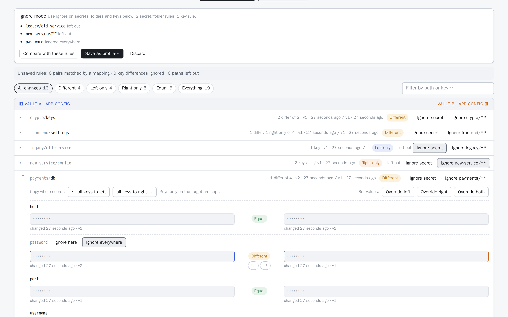

<!-- description: Stop expected differences between HashiCorp Vault environments from drowning out real drift: build a Lockstep comparison profile by clicking Ignore, map paths, and reuse it in the UI and CI. -->
# Building a comparison profile

Two environments that "match" never match exactly. Hostnames, URLs and per-environment passwords are meant to differ. Some folders exist in only one environment, and staging may keep its secrets under `staging/` where production uses `prod/`. A plain comparison flags all of it, and the real drift (the key someone forgot to add) is lost in the noise.

A [Lockstep](https://getlockstep.cloud) **comparison profile** records what's expected, so a comparison shows only what isn't. This guide builds one by clicking in the results, adds path mappings, and reuses it for exports, in the CLI and in CI.

## What a profile holds

| Rule | Example | Effect |
|---|---|---|
| **Ignored path** | `legacy/**` | Matching secrets are left out |
| **Ignored key** | `host` under `services/**` | Still listed, marked *ignored*, but its difference doesn't make the secret *Different* |
| **Path mapping** | `services/*/prod/**` ⇄ `services/*/staging/**` | Pairs `services/billing/prod/db` with `services/billing/staging/db` |

`*` matches within one path segment and `**` across any depth. A profile can also remember each side's mount and prefix.

## Pick what to ignore

1. Compare the two sides as usual.
2. Press **Pick what to ignore…**. Every secret gets **Ignore secret** and **Ignore *folder*/\*\***. In an expanded secret, every key that differs gets **Ignore here** (this secret only) and **Ignore everywhere** (every secret).
3. Click through the noise. Each pick is struck through straight away and listed in the bar above the results. Click it again to undo.

<picture>
  <source media="(prefers-color-scheme: dark)" srcset="../images/15-pick-ignore-dark.png">
  
</picture>

4. Press **Compare with these rules** to see the result before keeping anything. The summary line says how many key differences and paths the rules ignored. What's left is your real drift.
5. Press **Save as profile…**. The profile editor opens with your picks filled in; name it and save. If a personal profile was already selected, the button reads **Add to "*name*"…** and adds the picks to that profile instead.

Unsaved picks are kept until you save or **Discard** them, so you can go back and forth.

### What to ignore, and what not to

Good candidates:
- **Endpoints that differ by design:** `host`, `*_url`, `endpoint`. Ignore them where they live (`services/**`), not everywhere, if other secrets have keys with the same name that should match.
- **Values that are per-environment on purpose:** database passwords, API keys issued per environment.
- **Folders that only exist on one side:** `legacy/**`, scratch areas, per-environment feature flags.

Be careful with:
- **Ignore everywhere** on common names such as `password`. It also hides a password that *should* match, for example a shared service account. Prefer **Ignore here**, or a path-limited rule in the editor.
- **Ignoring whole secrets to make a report green.** A *Left only* secret is often exactly the drift you're looking for.

## Map paths when layouts differ

When one Vault uses `services/billing/prod/db` and the other `services/billing/staging/db`, a plain comparison reports every secret as *Left only* on one side and *Right only* on the other. Add a mapping in the profile editor (**Edit**, or **New**):

```
services/*/prod/**   ⇄   services/*/staging/**
```

Both sides need the same wildcards in the same order. What they match is carried across, so `billing` pairs with `billing`. The first matching mapping wins, and paths no mapping matches are compared as they are. Copies follow the mapping: copying a left-only `services/search/prod/config` writes `services/search/staging/config`. If two paths would map onto the same target, that pair shows as an error instead of being guessed.

## Share it

Profiles you make are **personal**: they're kept in your browser. To share one:
- **Between people:** **Export** downloads it as JSON. **Import** reads it in another browser.
- **For the whole team:** an admin adds it to the server's shared profiles: the Helm chart's `profiles` value (below), or `LOCKSTEP_PROFILES` as JSON with snake_case keys ([configuration](../configuration.md)). Everyone then sees it, read-only. **Duplicate** gives anyone an editable copy.

```yaml
# Helm values
profiles:
  - name: Prod ↔ staging services
    leftMount: app-config
    rightMount: app-config
    rules:
      mappings: [{left: "services/*/prod/**", right: "services/*/staging/**"}]
      ignoreKeys: [{key: host, path: "services/**"}, {key: "*_url"}]
      ignorePaths: ["legacy/**"]
```

## Reuse it everywhere

- **Exports:** the **Export & import** tab can *start from a profile's ignore rules*, so a backup leaves out the same paths and keys. `lockstep export --profile` does the same.
- **The command line:** `lockstep compare --profile prod-vs-staging.json` takes the exported file directly, or a shared profile's name. Use `--profile-name` if the file holds several profiles.
- **CI:** commit the exported profile next to your drift check, and only unexpected differences fail the build. See [Detecting secret drift in CI](detect-vault-secret-drift-in-ci.md).

## Next steps

- [How to compare secrets between two HashiCorp Vault clusters](compare-hashicorp-vault-clusters.md)
- [Exporting, importing and migrating Vault secrets](export-import-vault-secrets.md)
- [Usage guide: comparison profiles](../usage.md#comparison-profiles)
