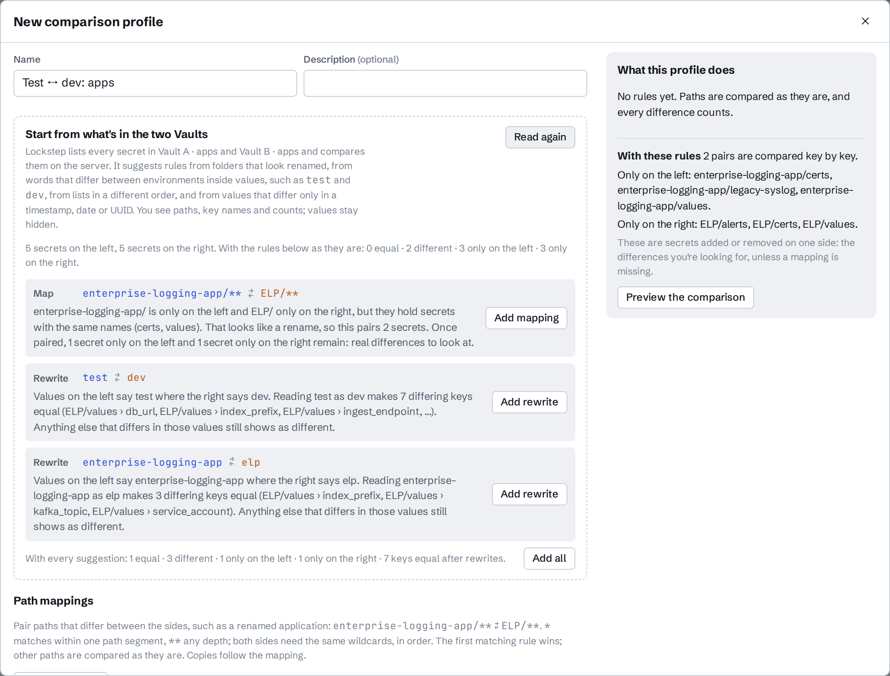
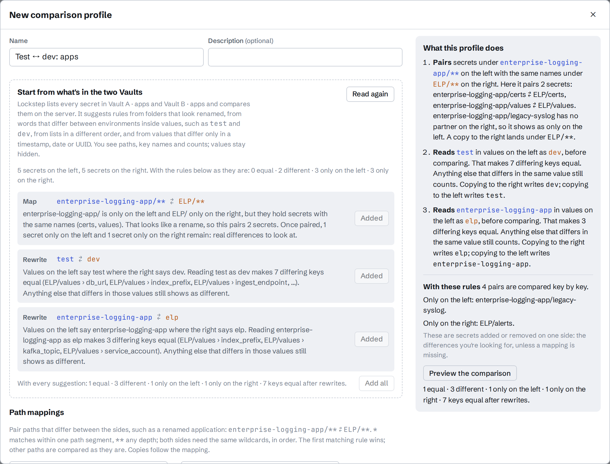
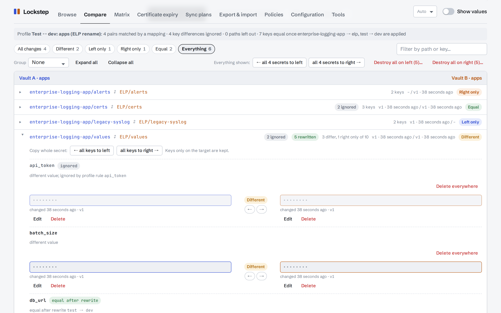

<!-- description: Compare HashiCorp Vault or OpenBao environments when an application has been renamed in one of them: map the old folder to the new one, rewrite environment words in values, ignore what must differ, and see only what has to ship. -->
# Comparing environments after an application is renamed

A team renames its application. In dev, the secrets move from `enterprise-logging-app/` to `ELP/`, and values change with it: the service account becomes `svc-elp`, the index prefix `elp-dev`. Test still runs the last release, under the old name. Before the next release someone has to answer one question: **what changed in dev that has to go to test?**

A plain comparison can't help. Every secret is on one side only, and every value that names its environment (`logs.test…` against `logs.dev…`) looks different. The two real changes are buried under dozens of differences that were always going to be there.

This guide builds a [Lockstep](https://getlockstep.cloud) comparison profile for this case, and explains each rule and why it's there. Everything in it runs on the dev stack and on the [live demo](https://demo.getlockstep.cloud/), where Vault A plays test and Vault B plays dev in a mount called `apps`.

## The two environments

| | Test (Vault A) | Dev (Vault B) |
|---|---|---|
| The application's folder | `enterprise-logging-app/` | `ELP/` |
| Its secrets | `values`, `certs`, `legacy-syslog` | `values`, `certs`, `alerts` |
| Other applications | `payments-gateway/config`, `search-indexer/config` | the same |

Inside `values`, the keys fall into four groups, and each needs different handling:

| Key | Test | Dev | What it is |
|---|---|---|---|
| `ingest_endpoint` | `https://ingest.test.logging…` | `https://ingest.dev.logging…` | Names its environment: equal in spirit |
| `index_prefix` | `enterprise-logging-app-test` | `elp-dev` | Names the environment and the application |
| `api_token` | `tok-test-8f2a…` | `tok-dev-3b9e…` | A credential: different in every environment, by design |
| `log_level` | `info` | `debug` | Verbose in dev on purpose |
| `batch_size` | `500` | `1000` | **Changed in dev since the release** |
| `otlp_endpoint` | | `https://otel.dev…` | **New in dev** |

The profile must make the first four groups quiet, and leave the last two loud.

## Which rule for which difference

A comparison profile has four kinds of rule. Picking the right one matters more than anything else in this guide:

| The difference | Rule | Why this one |
|---|---|---|
| A folder has another name on one side | **Path mapping** `enterprise-logging-app/**` ⇄ `ELP/**` | Pairs the secrets, so they're compared key by key instead of listed as missing |
| A value names its environment or application | **Value rewrite** `test` ⇄ `dev` | The rest of the value is still compared. A wrong host still shows as different |
| A value must differ per environment | **Ignored key** `api_token` | No rewrite could make two tokens equal, and none should |
| Secrets that don't matter here | **Ignored path** `scratch/**` | Left out entirely |

The common mistake is to ignore keys like `ingest_endpoint` because their values differ by environment. That makes the comparison quiet, but it also hides a dev endpoint someone copied into test by hand. A rewrite reads `test` as `dev` and then compares the whole value, so `https://ingest.test.logging…` matches `https://ingest.dev.logging…`, but `https://ingest.dev.logging…` on both sides doesn't.

## Build the profile from what's in the two Vaults

1. Connect both sides, and pick the `apps` mount on each: **Vault A** on the left, **Vault B** on the right.
2. In the **Comparison profile** bar, press **＋ New**, then **Read both sides**.

Lockstep lists every secret on both sides and compares them on the server. It suggests rules from two things only:
- **folder names:** a folder that exists only on the left, holding secrets with the same names as a folder that exists only on the right;
- **words that differ inside values:** but only words that are already visible in a path, or that are common environment names (`dev`, `test`, `staging`, `prod` and the like). A suggestion never shows any other part of a value.

<picture>
  <source media="(prefers-color-scheme: dark)" srcset="../images/29-profile-builder-dark.png">
  
</picture>

Each suggestion says why it was made:
- **Map `enterprise-logging-app/**` ⇄ `ELP/**`.** Both folders are one-sided, and they hold secrets with the same names (`certs`, `values`). That's what a rename looks like. The builder also says what's left once they're paired: `legacy-syslog` only in test and `alerts` only in dev. Those are real differences.
- **Rewrite `test` ⇄ `dev`.** Values on the left say `test` where the right says `dev`. Reading one as the other makes seven differing keys equal, across all three applications.
- **Rewrite `enterprise-logging-app` ⇄ `elp`.** Three keys still differ only by the application's old and new name. Note the lower case: values use `elp`, the folder `ELP`. Rewrites are case-sensitive, so the builder suggests the form the values actually use.

The line under the suggestions compares the counts before and after: without rules, nothing is equal and six secrets are one-sided; with them, two are.

3. Press **Add all**. The panel on the right, **What this profile does**, explains every rule in plain words, against the secrets that are actually there:

<picture>
  <source media="(prefers-color-scheme: dark)" srcset="../images/30-profile-explained-dark.png">
  
</picture>

It shows which secrets the mapping pairs (`enterprise-logging-app/values ⇄ ELP/values`), which have no partner, what each rewrite reads and writes, and what's still on one side only once all the rules apply. **Preview the comparison** runs the comparison with the draft rules, before you save anything.

4. Add the ignored keys by hand. The builder doesn't suggest these, on purpose: deciding that a difference doesn't matter is your call, not a pattern match.

| Ignored key | Under | Why |
|---|---|---|
| `api_token` | `**` | Each environment has its own token. Comparing them can only ever say "different" |
| `log_level` | `**` | Dev logs at `debug` on purpose |
| `tls.*` | `**/certs` | Each environment has its own certificate and key. `ca.crt` isn't ignored: both environments should trust the same CA, and the profile still checks that |

Keep ignored keys narrow. `tls.*` under `**/certs` hides only certificate files; a key called `tls.crt` anywhere else is still compared.

5. Name the profile and press **Save profile**. Keep **Remember the mounts and prefixes** ticked, so choosing the profile later selects `apps` on both sides.

The same profile ships with the dev stack and the demo as a shared profile, **Test ↔ dev: apps (ELP rename)**, so you can compare your result with it.

## What's left is what has to ship

Choose the profile and press **Compare**:

<picture>
  <source media="(prefers-color-scheme: dark)" srcset="../images/31-rename-compare-dark.png">
  
</picture>

- `enterprise-logging-app/values ⇄ ELP/values` is **Different**, but only because of `batch_size` (500 in test, 1000 in dev) and the new `otlp_endpoint`. Five keys show **equal after rewrite**, and two are **ignored**.
- `enterprise-logging-app/certs ⇄ ELP/certs` is **Equal**: the certificates are ignored, and the CA matches.
- `ELP/alerts` is **Right only**: new in dev.
- `enterprise-logging-app/legacy-syslog` is **Left only**: dropped in dev.
- `payments-gateway/config` is **Equal** once `test` is read as `dev`.
- `search-indexer/config` is **Different**: `workers` is 4 in test and 2 in dev. The profile can't know whether that's intended. If it is, ignore `workers` under `search-indexer/**`. If not, it's one more thing to fix.

The summary line counts how many keys the rewrites made equal, so nothing is hidden: you can always see how much the profile is doing.

## Release the changes to test

Copying respects the profile in both directions:
- **Paths follow the mapping.** Copying `ELP/alerts` to the left writes `enterprise-logging-app/alerts` in test, not `ELP/alerts`.
- **Values follow the rewrites, backwards.** A copy to the left reads `dev` as `test` and `elp` as `enterprise-logging-app`, so `pagerduty_service: elp-dev` arrives in test as `enterprise-logging-app-test`. The review marks every rewritten key **rewritten**, and with **Show values** on it shows the exact value that will be written.
- **Everything else is unchanged.** Each write is check-and-set and audit-logged, as with any copy. Certificates, keys and base64 data are never rewritten.

Once the release renames the application in test as well, update the profile. Remove the mapping and the `enterprise-logging-app` ⇄ `elp` rewrite, and keep `test` ⇄ `dev`: that one stays true for as long as the two environments exist.

## Use the profile from the command line and CI

**Export** the profile from the bar, or write it yourself:

```json
{"name": "Test ↔ dev: apps (ELP rename)",
 "left_mount": "apps", "right_mount": "apps",
 "rules": {"mappings": [{"left": "enterprise-logging-app/**", "right": "ELP/**"}],
           "rewrites": [{"left": "enterprise-logging-app", "right": "elp"}, {"left": "test", "right": "dev"}],
           "ignore_keys": [{"key": "api_token", "path": "**"}, {"key": "log_level", "path": "**"},
                           {"key": "tls.*", "path": "**/certs"}]}}
```

```sh
lockstep compare --left-addr https://vault-test.example.com --right-addr https://vault-dev.example.com \
    --profile test-dev.json
```

The report lists the rewrites it used, and `lockstep apply` applies them to copied values the same way the web UI does. To share the profile with everyone using Lockstep, add it to the server's `LOCKSTEP_PROFILES` (or the Helm chart's `profiles`, with `rewrites` under `rules`). See [configuration](../configuration.md).

## Every environment against the release: the matrix

A pair answers "what differs between test and dev". Before a release you also want to know how each environment has moved away from what's in production. The demo has that too: Vault A's `apps-baseline` mount holds the last release as it runs in prod, under the old name. Two more shared profiles line it up with each environment:
- **Release ↔ test: apps** rewrites `prod` ⇄ `test`.
- **Release ↔ dev: apps (ELP rename)** maps `enterprise-logging-app/**` ⇄ `ELP/**`, and rewrites the name and `prod` ⇄ `dev`.

Both ignore the tokens, the log level and the TLS material, as before.

1. On **Compare**, choose **Vault A** and `apps-baseline` on the left: it's the baseline. Choose **Vault B** and `apps` on the right.
2. Open **Matrix**. The baseline starts as the left side's (you can change it there). Name it `release`. The right side is the first environment: name it `dev` and pick the profile **Release ↔ dev: apps (ELP rename)**.
3. **Add environment**, name it `test`, choose Vault A's `apps` mount and the profile **Release ↔ test: apps**.
4. **Compare all**.

```
                                                  dev      test
  enterprise-logging-app/alerts                   extra    ·
  enterprise-logging-app/legacy-syslog            missing  =
  enterprise-logging-app/values · batch_size      ≠        =
  enterprise-logging-app/values · otlp_endpoint   extra    ·
  search-indexer/config · workers                 ≠        =
  enterprise-logging-app/values · retention_days  ≠        ≠
```

Test still matches the release, so dev's changes are the odd ones out and come first: the new alerts and OTLP endpoint, the bigger batch size and the dropped syslog. `search-indexer`'s workers differ in dev too, which is drift rather than a change to ship. `retention_days` differs everywhere, because prod keeps logs longer on purpose, so it comes last. The rename doesn't appear at all: `ELP/alerts` is listed under the baseline's name.

The same matrix runs from the command line with [`dev/matrix/apps.yaml`](https://github.com/welshstew/lockstep/blob/main/dev/matrix/apps.yaml) (`lockstep matrix dev/matrix/apps.yaml`). See [environment matrix](../cli.md#environment-matrix).

## Another example: prod against staging

The `app-config` mount on the demo has a second layout that profiles are made for: `services/<name>/prod/…` in Vault A and `services/<name>/staging/…` in Vault B. Two shared profiles handle it in two different ways:

- **Prod ↔ staging services** maps `services/*/prod/**` ⇄ `services/*/staging/**` and *ignores* `host`. Quiet, but a staging database host pointed at production would go unnoticed.
- **Prod ↔ staging services (rewrites)** uses the same mapping, and *rewrites* `prod` ⇄ `staging` instead. `db-prod.internal` matches `db-staging.internal`, while any other host still shows as different. It also makes `bk-prod` and `bk-staging` equal: if those are API keys that must differ, ignore that key on top.

Compare the two profiles on the same data and you'll see the trade-off directly. When the builder reads `app-config`, it suggests the wildcard mapping (it pairs every service, including ones added later) and the `prod` ⇄ `staging` rewrite.

## Rules of thumb

- **Map layouts, rewrite names, ignore what's meant to differ.** In that order of preference.
- **Prefer a rewrite over an ignored key** whenever the values differ only by an environment or application name.
- **Scope ignored keys** to the folders they belong to.
- **Read the explanation panel before saving.** If a mapping "matches nothing that has a partner", a name is wrong. If many secrets are still one-sided, a mapping is missing.
- **Keep one profile per pair of environments**, and change it when the layout changes, such as after a rename is released.

## Next steps

- [Building a comparison profile](build-a-comparison-profile.md): pick what to ignore from a comparison's results
- [Syncing secrets between environments safely](sync-vault-secrets-between-environments.md)
- [Detecting secret drift between Vault environments in CI](detect-vault-secret-drift-in-ci.md)
- [Usage guide: comparison profiles](../usage.md#comparison-profiles)
