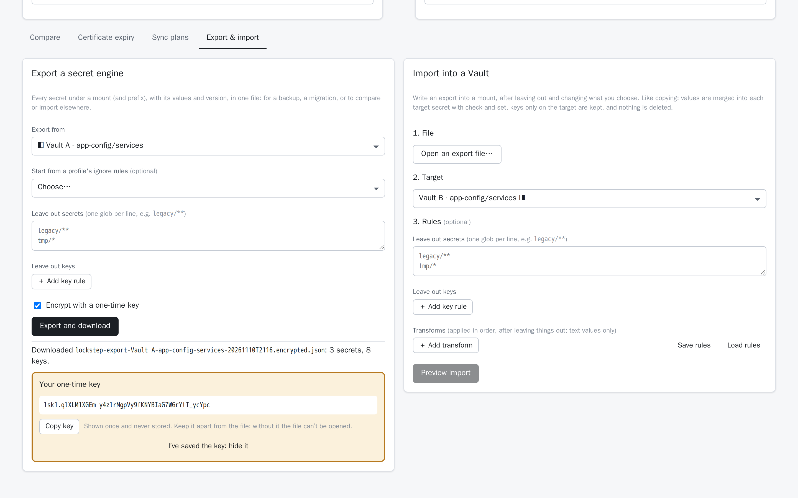
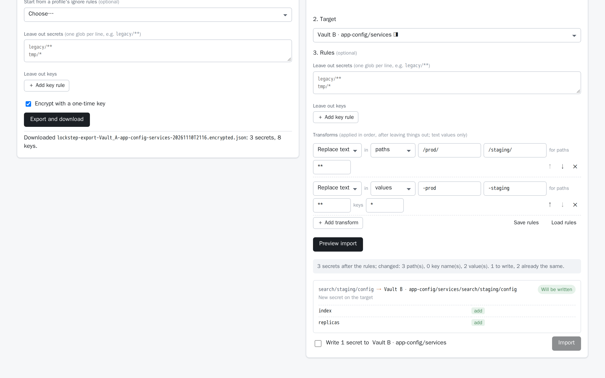

<!-- description: Export a HashiCorp Vault KV v2 mount to an encrypted file, compare a Vault against it, and import it into another environment with rules that rename paths and rewrite values. -->
# Exporting, importing and migrating Vault secrets

Sooner or later a whole set of secrets has to move. A new test environment needs everything dev has, with `dev` swapped for `test`. A cluster is being replaced. An audit asks what production looked like last month. You need a copy before a risky change.

The `vault` CLI can do this one secret at a time. A script that loops over `vault kv get -format=json` and `vault kv put` works, but the values sit in plain text, nothing previews what's about to change, and a rerun overwrites whatever someone changed in the meantime.

This guide does it with [Lockstep](https://getlockstep.cloud), in the web UI or from the command line:
- export a KV v2 mount (or part of one) to a file, encrypted by default;
- compare a live Vault against that file;
- import it elsewhere, with rules that leave things out and rewrite paths, key names and values.

## Export a mount

**In the web UI:**
1. Sign in to the Vault you want to export on either side, and choose the mount and an optional path prefix.
2. Open the **Export & import** tab. **Export from** shows that side.
3. Optionally, **leave out** secrets (globs such as `legacy/**`) and keys (a key pattern under a path glob, such as `*_token` under `**`). **Start from a profile's ignore rules** reuses the rules of a [comparison profile](build-a-comparison-profile.md).
4. Leave **Encrypt with a one-time key** ticked and press **Export and download**.

<picture>
  <source media="(prefers-color-scheme: dark)" srcset="../images/16-export-dark.png">
  
</picture>

The key is shown **once**. Copy it into your password manager, apart from the file, and press *I've saved the key*. Lockstep never stores it, so without it nobody can open the file, you included.

**From the terminal:**

```sh
lockstep export --vault-addr https://vault-prod.example.com --mount app-config --prefix services \
    --ignore-path 'legacy/**' -o services.json --key-file services.key
```

The CLI signs in like the `vault` CLI (`VAULT_TOKEN`, `~/.vault-token`, `--vault-auth userpass|ldap|jwt`). It writes the file and the key readable by you only. Without `--key-file` it prints the key once.

### What's in the file

An export is JSON. It holds each secret's current data, version and update time, where it came from, the rules used, and what was left out or couldn't be read. The format has a published [JSON Schema](https://getlockstep.cloud/schemas/lockstep-export-v1.json), and `lockstep schema export` prints it, so you can validate or process exports with your own tools.

Encrypted files use AES-256-GCM with a random 256-bit key (`lsk1.` plus 43 characters). A small header stays readable (the Vault name, mount, prefix, number of secrets and time) so you can tell files apart. It's authenticated, so editing it makes the file fail to open.

**Plain-text exports** (untick the box, or `--no-encrypt`) hold every value in the clear. Treat them like the secrets themselves. Admins can allow only encrypted exports, or turn exporting off, with `LOCKSTEP_EXPORT_MODE=encrypted|off` (chart value `exportMode`). Every export is audit-logged: who exported what, and whether it was encrypted. Values are never logged.

## Compare a Vault against an export

Either side of a comparison can be an export file instead of a Vault. Use it to see what changed since a backup, or to check that an environment still matches a snapshot.

1. On one side, switch **Vault / Export file** to **Export file** and open the file. Lockstep asks for the key if the file is encrypted.
2. Choose the mount on the other side and press **Compare**.

Everything works as it does between two Vaults: statuses, **Show values**, comparison profiles. You can copy values *from* the file into the Vault, through the usual review and check-and-set write. Nothing is ever written *into* a file. The opened file lives only in the page's memory and is gone when you close it.

## Import with rules

Importing writes an export into a mount, after the rules you set:

1. **File:** open the export, or pick one already opened in the page.
2. **Target:** the left or right side's Vault, mount and prefix. Exported paths go under it.
3. **Rules**, applied in this order:
   - **Leave out** secrets and keys, as when exporting.
   - **Transforms**, one after another: **Replace text**, **Add prefix**, **Add suffix**, **UPPERCASE** or **lowercase**. Each one applies to **values** (text values only), **key names** or **paths**, and can be limited to paths matching a glob and keys matching a pattern.
4. **Preview import** shows what the rules left out and changed, and for each target secret the keys it will add or update and the version it will become.
5. Tick the confirmation and **Import**.

<picture>
  <source media="(prefers-color-scheme: dark)" srcset="../images/17-import-dark.png">
  
</picture>

### Example: promote dev to test

Dev's secrets live under `dev/` and mention `application-dev-env` and a `devDBA` account. Test needs the same secrets under `test/`, pointing at test:

| Transform | In | Find | Replace with |
|---|---|---|---|
| Replace text | values | `application-dev-env` | `application-test-env` |
| Replace text | values | `devDBA` | `testDBA` |
| Replace text | paths | `dev/` | `test/` |

Transforms are plain text operations, not regular expressions, so a rule does exactly what it says and can't hang the server. A transform's path filter sees the path as the earlier transforms left it.

**Save rules** downloads the rules as JSON ([schema](https://getlockstep.cloud/schemas/lockstep-import-rules-v1.json)), so the next promotion is **Load rules** and **Preview**. The CLI reads the same file, in JSON or YAML:

```yaml
# promote-dev-to-test.yaml
ignore_paths: ["dev/scratch/**"]
ignore_keys: [{key: "*_debug", path: "**"}]
transforms:
  - {op: replace, target: values, find: application-dev-env, with: application-test-env}
  - {op: replace, target: values, find: devDBA, with: testDBA}
  - {op: replace, target: paths, find: "dev/", with: "test/"}
```

```sh
# Preview only
lockstep import dev.json --vault-addr https://vault-test.example.com --mount app-config \
    --key-file dev.key --rules promote-dev-to-test.yaml --dry-run

# Then for real: it asks once before writing (or --yes in automation)
lockstep import dev.json --vault-addr https://vault-test.example.com --mount app-config \
    --key-file dev.key --rules promote-dev-to-test.yaml --audit-log import.jsonl
```

`--replace FIND=WITH` (values) and `--replace-path FIND=WITH` add quick transforms on the command line. Use the `=` form for text that starts with a dash: `--replace=-dev-=-test-`.

### How it writes

An import writes the same way a copy does:
- **Merge:** values are merged into each target secret. Keys that exist only on the target are kept, and nothing is deleted (unless you [delete what isn't in the file](#make-the-target-match-the-file)).
- **Check-and-set:** each write is checked against the version the preview saw. A secret that changed in the meantime is reported as a conflict, not overwritten. Preview again and re-run.
- **Collisions:** if the rules would map two exported paths (or keys) onto the same target, that secret is left out, with the reason. Lockstep doesn't guess which one should win.
- **Audit:** every write is audit-logged, without values.

The CLI exits `0` when everything was written (or there was nothing to do). It exits `1` when some secrets weren't written, and `2` when it couldn't run.

## Make the target match the file

A merge never removes anything, so a key renamed in dev leaves its old name behind in test, and a secret retired in dev lives on in test. To make the target an exact copy, tick **Make the target match the file** (step 4), or pass `--delete-missing`:
- each imported secret is written with only the file's keys; other keys are **removed** in the new version (the old version stays in Vault's history);
- secrets under the target's mount and prefix that the file doesn't have are **soft-deleted**. `vault kv undelete` brings them back.

The preview lists every removed key and every deleted secret before anything happens:

```text
  update    test/app      env (update), legacy_flag (remove)
  delete    test/old-job  3 keys, v7

1 to write, 4 already the same, 1 to delete.
```

### Keeping secrets the file doesn't have

Some target secrets belong to the target only: test's own credentials, a secret another team manages. Add them to the file with `"keep": true` and no data, and the import leaves them exactly as they are:

```json
{
  "format": "lockstep.secret-export",
  "secrets": [
    {"path": "dev/app", "version": 12, "data": {"env": "application-dev-env"}},
    {"path": "dev/test-only-creds", "keep": true}
  ]
}
```

Keep entries go through the path transforms like everything else, so `dev/test-only-creds` above protects `test/test-only-creds` after a `dev/` → `test/` rename. Leave-out rules don't apply to them. To add keep entries to an encrypted export, export it again with **Encrypt** unticked (or `--no-encrypt`), edit it, and handle the plain file like the secrets it holds.

Things to know:
- Secrets left out by your **Leave out** rules count as *not in the file*, so they're deleted unless kept.
- Only what the preview listed is deleted, at the version it saw. A secret changed since then is a conflict; one created since then is left alone. Preview again to include it.
- Folders the token can't list are reported, and nothing in them is deleted.
- The token needs the `delete` capability on `<mount>/data/…` as well as `create` and `update`.

## Next steps

- [Syncing secrets between Vault environments safely](sync-vault-secrets-between-environments.md): copying individual keys with a review, and sync plans for someone else to apply
- [Building a comparison profile](build-a-comparison-profile.md): reuse the same ignore rules for exports and comparisons
- [Usage guide: export and import](../usage.md#6-export-and-import) and the [command-line reference](../cli.md#export-and-import)
- [Security: exports hold values](../security.md#exports-hold-values)
