<!-- description: How to use Lockstep: compare Vault KV v2 locations or an export, profiles, copying and overriding values, sync plans, value tools, certificate expiry, export and import, and explaining policies. -->
# Using the tool

## 1. Choose what to compare

Each side (left in blue, right in orange) needs:

- **a connection:** a Vault and a sign-in. See [authentication](authentication.md).
- **a KV v2 secrets engine.** Mounts are listed from `sys/mounts`. If the token can't read that, the list comes from what the token can access, and you're told it may be incomplete. You can always type a mount path, which is checked before use. KV v1 mounts are offered too, for comparing only (below).
- **an optional path prefix.** Paths are compared relative to each side's prefix, so `app-config/payments` can be compared with `app-config-staging/payments`.

Both sides can be the same Vault with different mounts or prefixes. ⇄ swaps the sides.

**▸ Left / source** and **▸ Right / target** collapse a side to one line: the account signed in, how (userpass, OIDC…), on which Vault and namespace, its policies and token expiry, and the mount and prefix. Click the line to open the side again. Each side remembers whether it was collapsed.

**KV v1 mounts** show as *KV v1, read-only* in the list. Lockstep compares them like KV v2, and you can copy **from** one into a KV v2 mount, which is how a migration off KV v1 usually goes. It never writes a KV v1 mount: copies, edits, deletes and sync plans toward one are refused, and the results offer no arrows into it. KV v1 keeps no versions, history or metadata, so those columns stay empty for that side. The other tabs (Browse, Policies, Expiry, Export) need a KV v2 mount and leave a KV v1 side out.

**Namespaces** (Vault Enterprise, OpenBao 2.3 and later): a side signed in to a Vault with namespaces shows a **Namespace** list of the child namespaces it can see. Picking one moves the side there with the same sign-in, so comparing the same path in two namespaces takes one sign-in. ↑ goes back up. A side opened this way says **Close** instead of **Sign out**: closing it keeps the sign-in it came from. Signing out of that sign-in closes its namespaces too. To sign in to a namespace directly, give it in the sign-in form.

**Or an export file.** Switch a side from **Vault** to **Export file** and open a [secret-engine export](#6-export-and-import) (with its key if it's encrypted), or [`vault kv get -format=json` output](#output-of-vault-kv-get), to compare a Vault against it: a backup, or another environment's export. *Show values* reads the file's values in the page. An export is read-only: you can copy values **from** it into a Vault, never into it, and it has no version history or value inspector. It's held in the page's memory only and is gone when you reload.

## Browse

**Browse**, the first tab and the one Lockstep opens on, explores one connection's KV v2 mount at a time. The **Connections** list across the top of the tab shows every signed-in connection: pick one, then its KV v2 secret engine and, optionally, a path prefix. Switching to another is one click, and a connection a side already uses starts on that side's mount. **Sign in to** adds another Vault without leaving the tab. Until you pick one, Browse starts on the left side's mount (or the right's).

<picture>
  <source media="(prefers-color-scheme: dark)" srcset="images/20-browse-dark.png">
  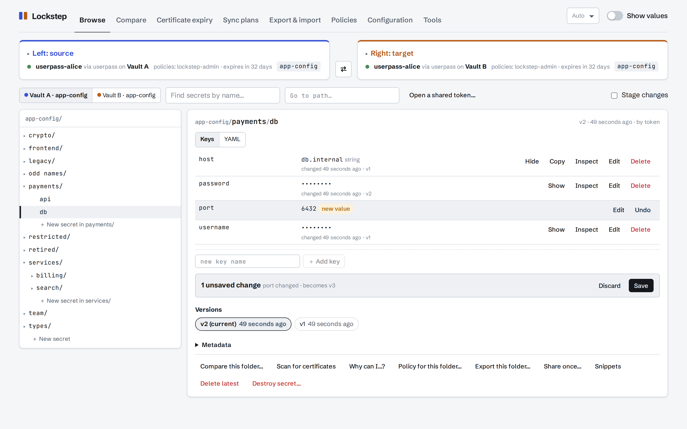
</picture>

- **The tree** lists folders as you open them, so a mount of any size opens straight away. Big folders show 200 entries at a time, and ⊘ marks what you can't list or read. **Find secrets by name** searches under the starting point; **Go to path** opens a path you type.
- **A secret** shows its keys with values masked. **Show** reveals one value (*Show values* at the top reveals all), **Copy** puts it on the clipboard, and **Inspect** opens the value tools. Under each value is when that key last changed.
- **Versions:** pick an older version to see it read-only, **Compare with** the current one key by key, **Roll back** to it (written as a new version), or undelete or destroy it. Each version says who wrote it and, if deleted, who deleted it (Vault 1.21 and later record this).
- **Metadata** shows the version settings and custom metadata, and who last changed the secret. **Edit metadata** changes:
  - max versions;
  - *require check-and-set*;
  - *delete versions after*;
  - custom metadata labels such as `owner` or `ticket`.

  Vault keeps no versions of metadata, so Lockstep checks that it hasn't changed since you opened it before saving.
- **Share once…** puts chosen values in a one-time token (Vault response wrapping) that expires after 5 minutes to 24 hours. Send the token instead of pasting a password into chat. The other person opens it with **Open a shared token…** (signed in to the same Vault) or `vault unwrap`. **Check** shows when it was made and when it expires without using it up; **Open** shows the values once, after which nobody can open it again. Sharing is audit-logged with the key names, never the values.
- **YAML** shows the whole secret as YAML, with values masked unless shown.
- **Limited access:** if you may see a secret's structure but not its values (Vault's `subkeys`), Browse shows the key names. If you may `patch` but not `update` a secret, your edits are sent as a patch (only the changed keys, with check-and-set), so you can change keys without reading the others.
- **Snippets** shows the `vault kv` commands, a `curl` call and a Terraform `vault_kv_secret_v2` block for the secret, and for your unsaved changes (as `vault kv patch`, or `put` when keys are removed), with placeholders instead of values. **Generate** in a value editor fills in a random 32-character value.
- **Links:** the address names the mount and secret (`#/browse/app-config/payments/db`), so the back button works and a link can be shared. It holds no connection or token: whoever opens it uses their own sign-in. Older links that also name a side (`#/browse/left/…`) still open. **Compare this folder…**, **Scan for certificates**, **Why can I…?** and **Export this folder…** put the secret's folder on the left side and open that tab.

### Editing

**Edit** turns a value into a text field (tick **JSON** to store a number, list or object), **Delete** marks a key for removal, **＋ Add key** adds one, and **＋ New secret** in the tree starts a secret. The changes collect under the secret as *unsaved changes*, with the version the write will create. **Save** writes them; **Discard** drops them.

- Every write is checked against the version you loaded (KV v2 check-and-set). If someone changed the secret in the meantime, nothing is written, the current version loads, and your changes stay so you can check and save again.
- Removing every key soft-deletes the latest version instead of writing an empty one.
- **Delete latest** soft-deletes the current version, and **Undelete** restores it. **Destroy secret…** uses the same typed confirmation as in Compare; destroying one version asks you to type `destroy vN`.
- **Stage changes** (top right) collects edits across secrets instead of saving each one; **Review & apply** shows them all, then writes them.
- Every write is [audit-logged](#audit-log) as `browse.write`, `browse.delete`, `browse.undelete`, `browse.destroy` or `browse.rollback`, with key names but never values.

## 2. Read the comparison

Press **Compare**. The server lists both trees, reads every secret on both sides, compares them, and returns **only statuses**: no values. They're dropped as soon as each secret has been compared.

| Status | Meaning |
|---|---|
| **Equal** | Same keys, same values |
| **Different** | At least one key differs, or exists on one side only |
| **Left only / Right only** | The secret exists on one side only (a soft-deleted latest version counts as absent, shown as *deleted*) |
| **Not compared** | Both sides are there and nothing else differs, but a key couldn't be compared: a keystore with a password that isn't stored in the secret, or a JKS private key that can't be decrypted. It isn't called different or equal. The key can still be copied |
| **No access** | One side can't list or read it. Its keys show as *unknown*, never as "only on the other side", so nobody copies over data they couldn't see |
| **Error** | Vault returned something else; the message is shown |

What counts as a difference:

- Only **values** count. Versions, timestamps and metadata are shown but ignored.
- Values are compared as canonical JSON: key order inside nested JSON doesn't matter.
- **Keystores are compared by their entries.** A PKCS#12 that opens without a password, or a JKS or JCEKS (whose certificates are readable without one), stored as base64, is compared as its aliases, certificates and keys. Saving it again (new timestamps, MAC salt, entry order) doesn't make it different: "equal as JKS keystores (same 2 certificates; entry order differs)". A difference is named: entries only on one side, which entry's certificates changed and how, or a different private key. A keystore with a password is opened with a password stored next to it in the same secret (a key whose name has `pass`, `pwd`, `pin` or `secret` in it, such as `keystore.password`), or with Java's default, `changeit`. This happens on the server, and the reason says which key opened it, never the password. When nothing opens it, the key is **not compared**, and the reason says so. The same goes for a JKS private key that can't be decrypted and is encrypted differently on each side.
- **Certificates, PEM and wrapped base64 are compared by what they hold.** Two texts with the same certificate, key or data are **equal** when they differ only in line endings, line wrapping or the spacing around PEM blocks, and the reason says how the text differs. Everything a service could read differently still counts: the PEM label (`BEGIN X509 CERTIFICATE` against `BEGIN CERTIFICATE`), a key in another format (PKCS#1 against PKCS#8), PEM against base64 DER, the order of certificates in a chain, base64 padding or alphabet, and a trailing newline on a one-line value. PEM with text outside its blocks (OpenSSL's `Bag Attributes`) or with `Proc-Type` headers is compared as text. To compare a key as text anyway, add it to the profile's **Compared as text** rules.
- `5432` (a number) and `"5432"` (a string) are different, and values are shown with their types.
- **Every key says why** it has its status, under its name, without showing a value:

  | Reason | When |
  |---|---|
  | different at `config.db.host` | The value is JSON or YAML on both sides (an object, or text holding one), and these fields inside it differ. Up to three are named; hover for the rest |
  | differs only in line endings (CRLF and LF), … in spaces or newlines at the start or end, … in upper and lower case | Two texts that look the same at a glance |
  | same content, written differently (spacing, key order or quoting) | Two texts holding the same JSON or YAML. They still count as different for now |
  | different type: number on the left, text on the right | `5432` against `"5432"` |
  | equal after rewrite `test → dev` | Equal once the profile's rewrites are applied, naming the ones used |
  | …; ignored by profile rule `log_level` | The difference doesn't count |
  | differs only in ignored fields | Every field that differs is ignored by a field rule (below) |
  | equal as certificates (same fingerprint; line endings differ) | The same certificate, written differently. Also *equal as private keys*, *equal as PEM* (a chain, or other blocks) and *equal as base64 (same 2048 bytes; line breaks differ)* |
  | renewed: new validity (same subject, issuer and names) | Two certificates for the same names: only the dates and serial changed (*and key* when the key did too) |
  | PKCS#12 keystore with a password on both sides: no key in the secret opens it … | **Not compared**: store the keystore's password next to it to compare it |
  | different certificate: subject, names (SANs) | Two certificates, naming the fields that changed: subject, issuer, names (SANs), validity, key, serial |
  | same private key, but PKCS#1 on the left and PKCS#8 on the right | The same thing in a form a service may not read the same way. Also a different PEM label, PEM against base64 DER, a chain in another order, and base64 with another alphabet |

  Values more than 8 levels deep, or with more than 1,000 fields, are compared whole past that point, and the reason says the list is incomplete. The CLI report carries the same `reason` and `paths`.

Filters (*All changes*, *Different*, *Left only*…, *Everything*) and the path/key search narrow the list. Folders a side couldn't list are named above the results.

- **Group:** *By folder* puts secrets under a header for each folder; click a header to fold it. *Staged first* lists what you've staged under its own header, ahead of the rest. The choice is remembered in your browser.
- **Expand all** and **Collapse all** open or close every secret shown.

### Values and metadata

- **Show values** (top right) reveals values, only for secrets you expand. They're fetched on demand and forgotten when you switch it off.
- Each secret's header shows each side's **current version and when it was written**. Under every value is **when that key last changed** (`changed 3 days ago · v2`). Vault only timestamps whole versions, so the tool works this out by walking back through the versions. `≥` means the history was cut short (deleted, destroyed or trimmed versions). None of this affects the comparison.
- A **badge** under each value says what it is (`PKCS#12 keystore · password needed`, `PEM · expired`…), even while values are masked. See [value tools](#4-value-tools).

## Comparison profiles

A profile tells Lockstep how the two sides relate, when they aren't laid out identically. Choose one in the **Comparison profile** bar, then compare.

<picture>
  <source media="(prefers-color-scheme: dark)" srcset="images/09-profile-dark.png">
  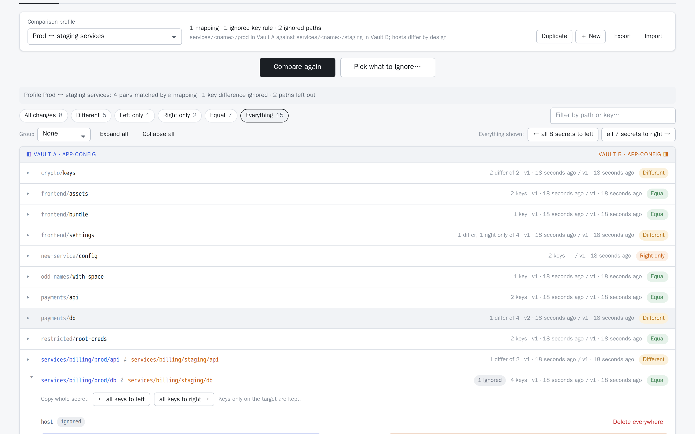
</picture>

| Rule | Example | Effect |
|---|---|---|
| **Path mapping** | `services/*/prod/**` ⇄ `services/*/staging/**` | Pairs `services/billing/prod/db` (left) with `services/billing/staging/db` (right). The row shows both paths |
| **Ignored key** | `host` under `services/**` | `host` is still shown, marked *ignored*, but its difference doesn't make the secret **Different** |
| **Ignored field** | `config` field `db.password` | For a key holding JSON or YAML: a difference in that field (and anything under it) doesn't count, but any other field that differs still does. `*` matches anything (`tls.*`), and list items are written `hosts[0]` |
| **Ignored path** | `legacy/**` | Matching secrets are left out of the comparison |
| **Compared as text** | `tls_*` under `apps/**` | No certificate, PEM or base64 comparison for these keys: a value written differently counts as different, and the reason says it would otherwise be equal |
| **Value rewrite** | `test` ⇄ `dev` | Values are compared with each left word read as its right word: `logs.test.internal` matches `logs.dev.internal`, a different host still doesn't. The key is marked *equal after rewrite*. A rewrite can be limited to keys (`*host*`) and secrets (`apps/**`), so it never changes a word inside a password or token; copies follow the same limits. A rewrite can be a **pattern** with placeholders: `{app}-test-db` ⇄ `{app}-dev-db` reads `billing-test-db` as `billing-dev-db`, and copies the other way read it back. A placeholder stands for one word (letters and digits) and sits next to a `-`, `.`, `_`, `/` or the end |
| **Unordered list** | `allowed_hosts`, or `config` field `tls.sans`, or `domains` split on `,` | The same items in another order are equal ("same items in a different order"); duplicates count. For a list inside JSON or YAML, name the *field*; for a list in plain text, the *separator*. A list that differs is named as a whole (`tls.sans`), not item by item |
| **Volatile pattern** | `\d{4}-\d{2}-\d{2}T[0-9:.]+Z` in `*` under `apps/**` | Text matching the regex is blanked on both sides before comparing. A key that differs only there is shown, marked *ignored*, with the pattern as the reason. A pattern that matches empty text, or repeats a group that repeats inside (`(a+)+`), is refused |

How the rules work:
- **Patterns:** `*` matches within one path segment and `**` across any depth. Both sides of a mapping need the same wildcards in the same order, and what they match is carried across. The first matching mapping wins. Paths no mapping matches are compared as they are.
- **Copies follow the mapping.** Copying a left-only `services/search/prod/config` to the right writes `services/search/staging/config`.
- **Collisions are refused, not guessed.** If two left paths map onto the same right path, that pair shows as an **Error** explaining which paths collide.
- **Mounts too:** a profile can also remember each side's mount and prefix, applied when you pick it.
- **Rewrites match whole words,** case-sensitive: `test` never touches `latest`. Certificates, keys and base64 data are never rewritten. A copy writes the target side's word (a copy to the right turns `test` into `dev`, a copy to the left the other way), and the review marks each rewritten key.
- **The summary line** says how many pairs a mapping matched, how many key differences and paths the profile ignored, and how many keys are equal only after rewrites.

**Shared and personal profiles:**
- *Shared* profiles come from the server (`LOCKSTEP_PROFILES`, see [configuration](configuration.md)), so a team sees the same rules. They're read-only: **Duplicate** makes an editable copy.
- *Personal* profiles are saved in your browser. **New** and **Edit** open the editor; **Export** and **Import** move them between browsers or people as JSON.

### Building a profile from what's in the two Vaults

With a mount chosen on both sides, **＋ New** (or **Edit**) and then **Read both sides** lists every secret on each side and suggests rules, each with the reason it was made:
- **A mapping** for a folder that's only on one side and holds secrets with the same names as a folder only on the other: a rename, such as `enterprise-logging-app/**` ⇄ `ELP/**`. When the folders differ in an environment segment under a varying parent, the mapping uses a wildcard (`services/*/prod/**` ⇄ `services/*/staging/**`).
- **A rewrite** for a word that differs between values and makes them equal once read as its counterpart, with how many keys it fixes. Words come only from paths and common environment names (`dev`, `test`, `staging`, `prod`…), so a suggestion never reveals any other part of a value.
- **An unordered list** for a key whose two values hold the same items in another order: a JSON or YAML list, or text with items separated by commas.
- **A volatile pattern** for a key whose two values differ only in a timestamp, a date or a UUID. Only these three fixed patterns are suggested. Think before adding one for a date that matters, such as an expiry date.

**Add** or **Add all** puts them in the editor. The **What this profile does** panel explains each rule in plain words against the secrets actually there (which pairs a mapping makes, what's still one-sided), and **Preview the comparison** runs it before you save. Ignored keys are left to you: deciding a difference doesn't matter is a judgement, not a pattern. The guide [Comparing environments after an application is renamed](guides/compare-environments-after-a-rename.md) walks through it.

<picture>
  <source media="(prefers-color-scheme: dark)" srcset="images/30-profile-explained-dark.png">
  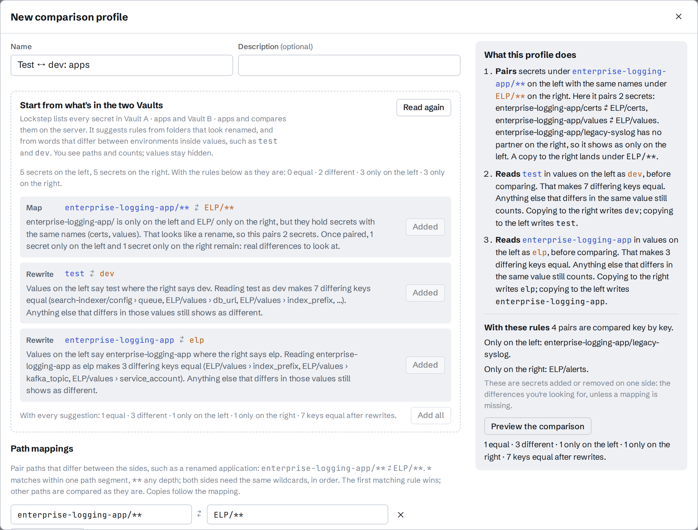
</picture>

### Building a profile from a comparison

You don't need to write patterns to ignore things. Compare, then press **Pick what to ignore…**:

- **On a secret:** **Ignore secret** leaves that secret out; **Ignore *folder*/\*\*** leaves out everything in its folder.
- **On a key** (in an expanded secret, for keys that differ): **Ignore here** ignores that key's differences in this secret only; **Ignore everywhere** ignores it in every secret.

Each pick is struck through straight away and listed in the bar above the results. Pressing it again undoes it. **Compare with these rules** runs the comparison with your picks on top of the selected profile, so you can check the effect before keeping them. **Save as profile…** opens the profile editor with the rules filled in: name it and save. If a personal profile is selected, the button reads **Add to “*name*”…** and adds the picks to it. With a shared profile, it saves a copy. Unsaved picks are kept until you save or **Discard** them.

<picture>
  <source media="(prefers-color-scheme: dark)" srcset="images/15-pick-ignore-dark.png">
  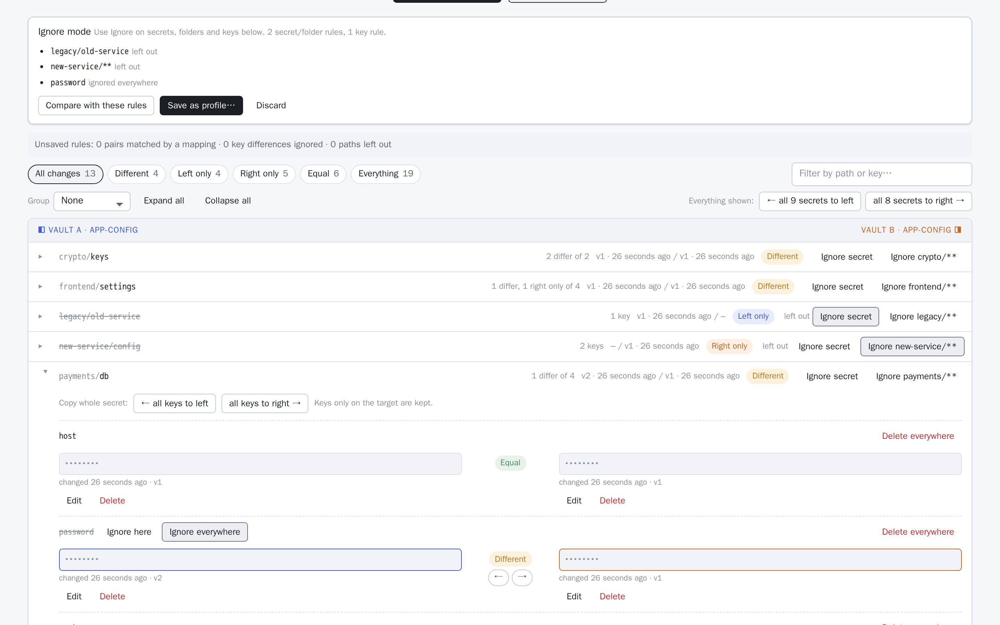
</picture>

## Environment matrix

The **Matrix** tab compares one baseline with several environments at once, for example prod against staging, dev, test and preview environments. Like Browse, the tab has a **Connections** list across the top instead of the left and right side cards: every signed-in connection, and **Sign in to** for another. The baseline is picked in the matrix: any signed-in connection with a KV mount and path prefix, or an export file (**Open an export file…** in the baseline list), such as last release's export or a backup. It starts as the left side's. Add an environment for each place to compare with it: a name, a signed-in connection, a KV mount, a path prefix and, optionally, the comparison profile for that pair. The right side is offered as the first environment. **Open in Compare** puts the baseline on the left and that environment on the right.

**Compare all** compares the baseline with each environment, up to 12, and shows a grid. There's a row per secret and per key, and a column per environment:

| Cell | Means |
|---|---|
| = | the same as the baseline (or equal under that pair's profile) |
| ≠ | differs from the baseline |
| missing | the baseline has it, this environment doesn't |
| extra | this environment has it, the baseline doesn't |
| ? | couldn't be compared: unreadable, a keystore without its password, or the comparison failed |
| · | neither has it |

**Accepted drift** (optional, per environment) is a drift baseline for that pair: the `base.json` a drift check uses, written by `lockstep baseline update`. A difference it lists with the same status is still shown, marked `*` and greyed, but doesn't count: it doesn't make the environment the odd one out, and rows with only accepted drift come last. With another status (a key that was missing and now differs) it counts as new. A drift file for other mounts or prefixes is refused. Under the environment's name, the grid says which file it used and how many of its differences have since been resolved.

Rows that differ in only one environment come first, marked on the left: one environment out of line is the likeliest mistake. Rows where every environment differs come last, because those are usually meant to differ. Hover over a cell for the reason. **Open in Compare** under an environment's name opens that pair side by side, with its profile, to look closer or copy values. **Download CSV** saves the grid. Values are never shown or saved. The environments you set up are remembered in this browser, without tokens.

To try it on the demo data, compare the last release (Vault A's `apps-baseline`) with test and dev: see [Every environment against the release](guides/compare-environments-after-a-rename.md#every-environment-against-the-release-the-matrix).

`lockstep matrix` does the same from a file, for scripts and CI. See [Command line](cli.md#environment-matrix).

## 3. Copy values between the sides

- **← / →** next to a key stages a copy of that key toward that side. A key can only travel one way.
- **all keys to left / right**, inside an expanded secret, stages every key the source has. It also shows as pressed once you've staged every differing key one at a time; pressing it then unstages them.
- **Many secrets at once:** with *Group: By folder*, each folder header has **← all *n* secrets to left** and **all *n* secrets to right →**. Above the results, the same buttons act on everything shown, so you can type a path into the filter and move everything under it. Press a pressed button again to unstage.
- A dashed outline marks each value that will be overwritten. The bar at the bottom counts what's staged.

### Override values

To set a value yourself instead of copying the other side's, expand the secret and choose **Edit** under the value, on the side you want to change. The value becomes a text field: type the new value and **Set value** (or Ctrl/⌘+Enter). With *Show values* on, the field starts from the other side's value if it has the key, otherwise from this side's own. With it off, nothing is fetched: the field starts empty and what you type is masked. Values are text unless you tick **JSON**, which stores numbers, booleans, objects and lists as those types.

To add a key the secret doesn't have yet, type its name at the bottom of the secret and choose **＋ Add to left**, **＋ Add to right** or **＋ Add to both**.

<picture>
  <source media="(prefers-color-scheme: dark)" srcset="images/13-override-dark.png">
  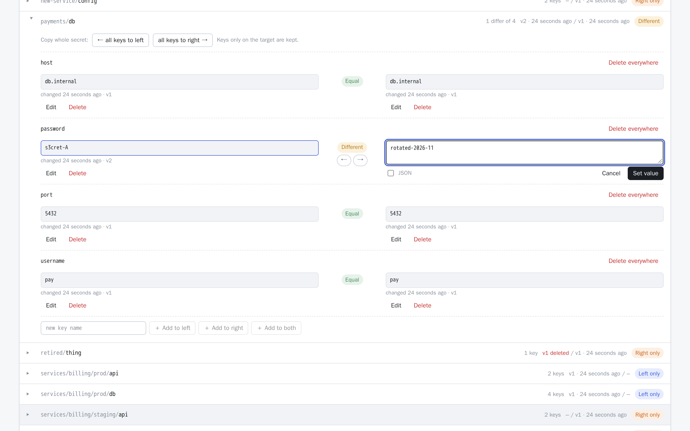
</picture>

A staged value takes the place of what that side shows, marked **new value**, with **Edit** to change it and **Undo** to drop it. Typed values go through the same review and apply as copies: check-and-set against the version you compared, other keys kept. Typed values and copies into the same secret are written together, as one new version. A key is either copied or typed on a side, not both: staging one replaces the other.

Typed values are the only values the browser sends to the server. They're kept in the page until you apply or clear them, and aren't audit-logged: the log lists the overridden key names only. A [sync plan](#sync-plans) can hold them, if you agree to it.

### Delete keys

**Delete** under a value stages removing that key from that side; **Delete everywhere** (next to the key's name) does it on both sides. The value is shown struck through as **will be removed** until you **Undo** it. On apply, the secret gets a new version without the key, written with check-and-set like any other change. Earlier versions still hold the key, so `vault kv rollback` can bring it back. Deleting a key needs only write access to the secret.

Removing **every** key of a secret doesn't write an empty version: the secret's latest version is soft-deleted instead (the review says so), and `vault kv undelete` brings it back. That needs the `delete` capability on `<mount>/data/…`.

### Destroy secrets

**Destroy on left… / right…** at the bottom of an expanded secret permanently deletes that secret on that side: **every version and its metadata** (`vault kv metadata delete`). **Destroy all on left… / right…** above the results does it for every secret shown on that side, so narrow it with the status chips and the filter first (`preview-123/`).

Destroying doesn't go through the review. A dialog lists the secrets, warns that it can't be undone, and waits until you type a confirmation phrase: the secret's path for one secret, `destroy N secrets` for several. Then:

- each secret is checked against the version you compared: one written since is skipped as **Changed: not destroyed**
- only that side is touched
- every attempt is [audit-logged](#audit-log) with `"event": "destroy"`, the version and how many versions went. No values are read.
- the comparison runs again when you close the dialog (staged changes are cleared)

Nothing can bring a destroyed secret back, so [export](#6-export-and-import) it first if you might need it. Destroying needs the `delete` capability on `<mount>/metadata/<path>`. A server admin can turn the feature off with [`LOCKSTEP_ALLOW_DESTROY=false`](configuration.md).

**Review & apply** opens a preview for each target secret: keys **added**, **updated** or **removed** (with old → new values if *Show values* is on), the version it will become, and any problems. **×** next to a key takes it out of the changes, and **Remove** takes out a whole secret; the preview updates to match.

| Preview status | Meaning |
|---|---|
| Will be written | Ready |
| Already the same | Nothing to do |
| Changed since compare | The target's version moved since you compared. Compare again |
| No permission | The target token can't write there (`sys/capabilities-self`) |
| Can't copy | The source no longer has that key or data |

Tick the confirmation (it names the target Vaults and mounts) and **Apply**. Then:

- **Fresh source values:** copied values are **read again from Vault**, never taken from the browser. The only values the browser sends are the ones you typed as overrides.
- **Check-and-set:** each write uses KV v2 **check-and-set** against the version you saw. If someone else changes the target in the meantime, that secret comes back as **Conflict: not written**; the rest still go through.
- **Nothing deleted unless you asked:** keys that exist only on the target are kept. Only keys you chose to **Delete** are removed, and then only from the new version (or, when every key goes, by soft-deleting the latest version).
- **Types preserved:** a number stays a number.

Results are shown for each secret, then the tool compares again.

### Audit log

Every attempted write, applied or not, produces one JSON line on the server's stdout:

```json
{"event": "sync.apply", "outcome": "applied", "ts": "2026-11-08T12:00:00Z",
 "actor": {"source_identity": "oidc-alice@example.com", "source_auth": "oidc",
           "target_identity": "oidc-alice@example.com", "target_auth": "oidc"},
 "source": {"vault": "Vault B", "url": "http://vault-b:8200", "mount": "app-config", "path": "frontend/settings", "version": 8},
 "target": {"vault": "Vault A", "url": "http://vault-a:8200", "mount": "app-config", "path": "frontend/settings",
            "old_version": 8, "new_version": 9},
 "keys": ["cdn_url"], "overridden": [], "message": ""}
```

Values are never logged: `keys` lists every key written and `overridden` the ones set from typed values. Outcomes are `applied`, `conflict`, `denied`, `invalid` and `error`.

**Who saw which values.** With `LOCKSTEP_AUDIT_REVEALS=on`, every response that carries secret values adds a `secret.reveal` line. Responses with values are Browse **Show**, version diffs and edit previews with values, values shown in Compare, revealed sync and import previews, **Inspect** and its downloads, and unwrapping a shared secret. There's one line per request, listing the secrets and the key names, never the values:

```json
{"event": "secret.reveal", "how": "browse.show", "request_id": "3f9a1c2e", "ts": "2026-11-26T09:00:00Z",
 "actor": [{"vault": "Vault A", "identity": "oidc-alice@example.com", "auth": "oidc"}],
 "secrets": [{"vault": "Vault A", "url": "http://vault-a:8200", "mount": "app-config", "path": "payments/db",
              "version": 4, "keys": ["password", "username"]}], "more": 0}
```

`request_id` matches the [server log](configuration.md#logging) line for the same request. A request that shows more than 200 secrets lists the first 200 and counts the rest in `more`. It's off by default because showing values is routine; turn it on when you need to answer "who looked at this production secret?".

### Sync plans

A plan is a reviewed set of changes saved as a file, so one person can prepare the changes and
another (with write access to the targets) can apply them later. It's also a report of what
needs updating from where.

**Save a plan.** Stage copies as usual and open **Review & apply…**. Add an optional note and
choose **Save as plan**. You don't need write access to the targets to do this: a read-only
user can prepare a plan for someone else. Lockstep downloads `lockstep-plan-<date>-<id>.json`;
**Download report** gives the same plan as a Markdown table (from, to, key, add, update or remove).
Changes that conflict or can't be read can't go into a plan: compare again first. Keys whose
target already has the same value are left out.

A plan records, for each secret: the source and target paths, the keys and whether each is
added, updated or removed, and the version of the source and target at the time. **Copied
values are never in it**: they're read from the source when the plan is applied. **Values you
typed aren't in it either.** For each typed key the plan keeps a check code, made with the
server's secret key, which can't be turned back into the value. Whoever applies the plan types
the values again under **Values typed by hand** in **Sync plans**, so tell them what to type.
Lockstep checks each one against the code before anything is written, and refuses one that
doesn't match: a typo never reaches Vault. **Check plan** works before the values are typed.
The report marks those keys *typed*. Plans saved by earlier versions, which held the typed
values (`holds_values`), still apply as they are. A plan also records who created
it on each side, with their Vault entity ID and token accessor (identifiers a token can't
choose, to match against Vault's audit log), the comparison profile (if any) and the note.
The file is signed, so any edit to it is detected and the plan is refused. A plan can be
applied for 7 days by default, and **Valid until** shows when it expires.

By default a plan is signed with a key derived from `LOCKSTEP_SESSION_KEY`, so it applies
only on a Lockstep with the same session key, and changing that key invalidates existing
plans. To make a plan on one installation (dev) and apply it on another (prod), give the
installations an Ed25519 key pair: see [plans between installations](configuration.md#plans-between-installations).
A plan can also name the installations that may apply it: **Only for**, next to **Save as plan** (and **Save as access plan**), takes their names, comma-separated. It suggests this installation's name and those it trusts, and points out a name it doesn't know, because only an installation with that exact name can apply the plan. Empty means any installation that trusts this one.
**Made on** shows which installation made it. A plan from another installation
can't check typed values against its creator's, so you type each of them twice.

**Apply a plan.** Connect both sides to the Vaults the plan names (any identity with write
access to the targets), open the **Sync plans** tab and choose **Open a plan file…**. Check
the report, then **Check plan**: Lockstep reads every source and target now.

- If every secret is exactly as it was when the plan was made, tick the confirmation and
  choose **Apply plan**. Each write uses check-and-set and is audit-logged with the plan's ID
  (`"plan_id"` in the `sync.apply` event).
- If **any** source or target has changed since then, the whole plan is refused and nothing
  is written. The person applying it is told to ask for a new plan, made from a fresh
  comparison.
- If you lack write access to any target, nothing is written either.

The check runs again when you apply. If a source or target changes in the moment between that
check and its write, that write is refused: a target by check-and-set, a source because the
version being copied must be the one in the plan. Applying then **stops**: the secrets after it
aren't attempted, and the result says **Partially applied: N of M written** (or **Not
applied**), naming the secret it stopped at. Writes that already happened stay; compare again
and make a new plan for what's left.

**Approvals.** Where the server asks for them (see [four-eyes approvals](configuration.md#four-eyes-approvals)),
**Check plan** shows whether the plan is approved, and **Apply plan** waits until someone other
than its creator has approved it. To approve, open the plan, **Check plan**, then **Approve**:
the approved file downloads, ready to pass on to whoever applies it. Undo plans and access plans
take approvals the same way.

### Undo an apply

After copies or a plan are applied, **Make an undo plan** (in the review dialog, or under a
plan's result in **Sync plans**) downloads a signed file that undoes them. It's offered after an
import too, and in Browse after a save or an applied review of staged edits. For each secret
written, it records the version the apply replaced and the version it left. It holds no values.

Open it in **Sync plans**, **Check undo plan**, tick the confirmation and **Apply undo plan**:

- **A secret that was overwritten** gets its old version back: Lockstep reads that version from
  Vault's KV history and writes it again as a new version, with check-and-set.
- **A secret the apply created** is soft-deleted, and **one it soft-deleted** is undeleted.
- **From Browse,** writes and rollbacks are undone this way, and a soft-delete of the latest
  version is undeleted. An undelete, a destroy, or deleting older versions can't be.
- **Nothing is undone** for a secret someone has written since the apply, or whose old version
  has been deleted or destroyed (KV v2 keeps 10 versions by default). Like a plan, the check is
  all or nothing, and applying stops at the first secret that isn't put back.

Undo plans are signed and expire like sync plans, and travel between installations the same
way. Each secret put back is audit-logged as `undo.apply`, with the undo plan's ID and the
plan it undoes.

## 4. Value tools

**Inspect** (under the status of a key with a badge) opens that key's value from one or both sides. The value is identified by **content, not by key name**, through as many layers as it has: base64 → PEM → certificates, base64 → DER, and so on.

| Detected | What you get |
|---|---|
| X.509 certificate, PEM bundle, PKCS#7, DER | Subject, issuer, names (SANs), validity, key usage, key type, serial, fingerprints. **Chain validation** link by link: signature, issuer is a CA, dates. The verdict is *trusted*, *untrusted root*, *incomplete* or *invalid* |
| PKCS#12 | Opens with a typed password, one taken from another key in the same secret (keys named like `*pass*` are suggested), or one the [password finder](#finding-a-keystore-password) locates elsewhere. Lists the private key and certificates, and checks the key matches its certificate |
| JKS / JCEKS | Certificates are listed without a password. With it, the keystore's integrity is verified and JKS private keys are decrypted and matched to certificates. JCEKS private keys are shown as present only |
| Private key, encrypted key, public key, CSR | Type and size; which certificate (in this value or elsewhere in the secret) the key belongs to |
| PNG, JPEG, GIF, WebP, ICO, SVG | Preview. SVGs are shown as images, so scripts inside them never run |
| ZIP / JAR, GZIP, PDF, other binary | File list (ZIP), hex preview, download |

<picture>
  <source media="(prefers-color-scheme: dark)" srcset="images/08-inspect-jks-dark.png">
  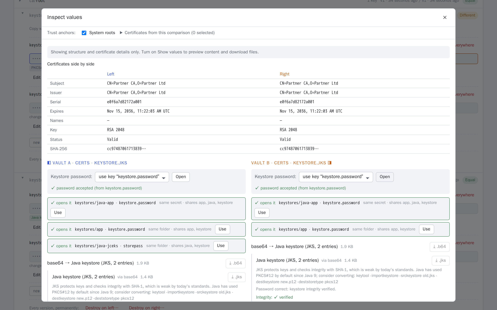
</picture>

**Chains.** Intermediates are taken from the value itself and from the secret's other keys (`chain.pem`, `ca.crt`…). Trust anchors are the **system roots** (Mozilla's list), any certificate key from the comparison you tick, or **Trust this root**, offered for a self-signed root found alongside the value. Anchor choices apply to that inspection only and aren't saved.

**Both sides.** When a key exists on both sides, Inspect opens them in two columns and compares their first certificates field by field. For example, a renewed certificate shows the same subject and a new serial and expiry.

**Previews and downloads** need *Show values*. Private keys inside keystores can't be downloaded. Keystore passwords are used for that one request only.

### Finding a keystore password

Keystore passwords often live away from the keystore, for example `some-secrets/files/certs.p12` with its password in `some-secrets/strings/KEYSTORE_PASSWORD`. When the inspector opens a locked keystore, it looks for the password straight away:

<picture>
  <source media="(prefers-color-scheme: dark)" srcset="images/14-password-finder-dark.png">
  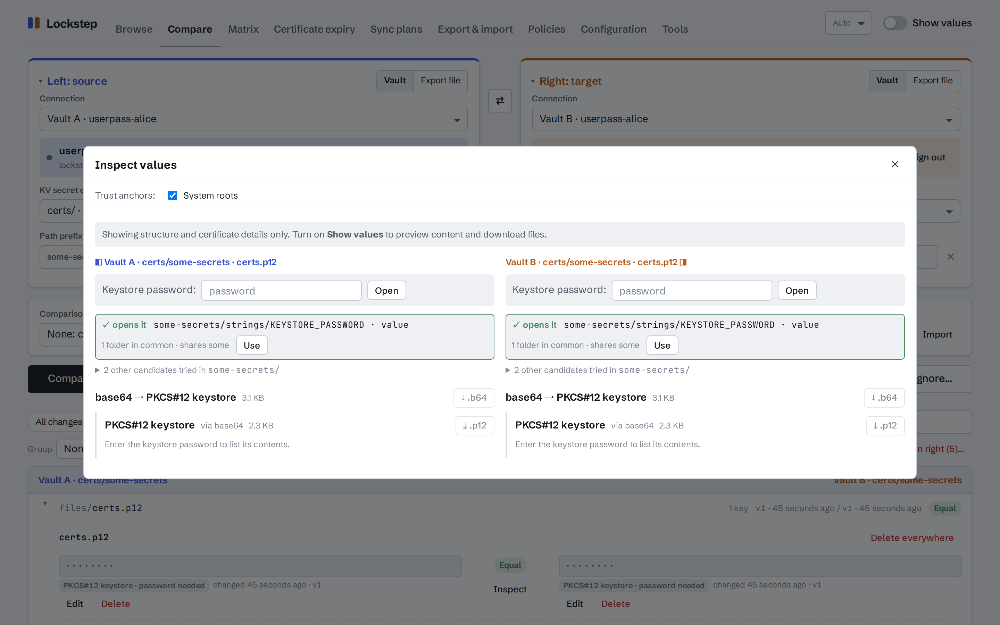
</picture>

1. It searches the keystore's **top-level folder** (`some-secrets/` here; the whole mount for a secret at the root), up to 500 secrets.
2. **Candidates** are short, single-line values whose key name or secret name looks like a password (`*pass*`, `*pwd*`, `*pin*`, `*secret*`), or that sit in a folder named like one (`passwords/`, `creds/`…).
3. They're **ranked** by closeness (same secret first, then the most folders in common) and by shared name words, so `CERT_PASSWORD` ranks high for `certs.p12`.
4. The server **tries** the 40 best against the keystore. Ones that open it are listed first with **Use**; the others are listed as tried. If none does, Java's default password (`changeit`) is tried too.

Only where each candidate is (path and key) and whether it opens the keystore come back, never the values, and nothing is written. You need read access to the secrets searched; folders you can't list are skipped.

## 5. Certificate expiry

The **Certificate expiry** tab scans the mounts (and prefixes) chosen on one or both sides for **every certificate stored anywhere**: PEM certificates and bundles, DER, base64-wrapped forms, PKCS#12 files, and JKS/JCEKS keystores. All are found by content, not key name.

<picture>
  <source media="(prefers-color-scheme: dark)" srcset="images/11-expiry-dark.png">
  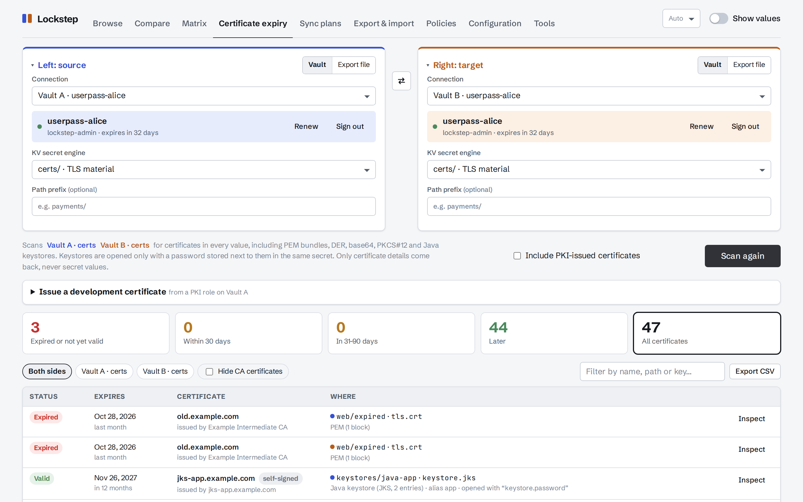
</picture>

- **Tiles** split the certificates into expired or not yet valid, within 30 days, in 31–90 days, and later. Each certificate is in exactly one tile. Click a tile to show just that group.
- **Each row** shows the certificate (subject, issuer, CA or self-signed), when it expires, and where it lives: side, path, key, the container (e.g. *PKCS#12 keystore*, alias) and, for keystores, which key's password opened it.
- **Filter and export:** filter by side, hide CA certificates, search, and **Export CSV** what's shown.
- **Inspect** opens the value in the [value tools](#4-value-tools).

Keystores that need a password are opened with a password stored in the same secret (keys named like `*pass*`, `*pwd*`), or else with the 10 best candidates the [password finder](#finding-a-keystore-password) ranks from the keystore's top-level folder within the scanned tree: keys you can already read. The row says which key opened it. Keystores that can't be fully checked are listed under *not fully checked*, never silently skipped. Only certificate details come back from the server, never secret values.

**Include PKI-issued certificates** also lists every certificate the Vaults' PKI engines have issued (except revoked ones), and their issuing CAs. That way certificates Vault issued expire on the same timeline as those stored in KV secrets. They show as *PKI-issued* or *PKI issuer*, with the engine and serial. It needs `list` and `read` on `<pki>/certs` and `<pki>/issuers`.

### Issue a development certificate

When a side's Vault has a PKI secrets engine, **Issue a development certificate** (at the top of the tab) issues one from a PKI role:
- **Before issuing:** it shows the issuing CA and what the role allows (names, maximum TTL, key type).
- **Issuing:** you give a common name, other names and a validity.
- **Afterwards:** you can download the certificate, private key, CA chain or full chain, and optionally store all three in a new KV secret on the side's mount (`certs/<name>` by default; an existing secret is never overwritten). **Inspect** opens the stored certificate in the value inspector.

The private key is shown only then. Issuing is audit-logged with the serial number, never the key, and is refused when the server is read-only. Configuring PKI itself (CAs, roles) stays in the Vault UI or Terraform.


<picture>
  <source media="(prefers-color-scheme: dark)" srcset="images/27-pki-issue-dark.png">
  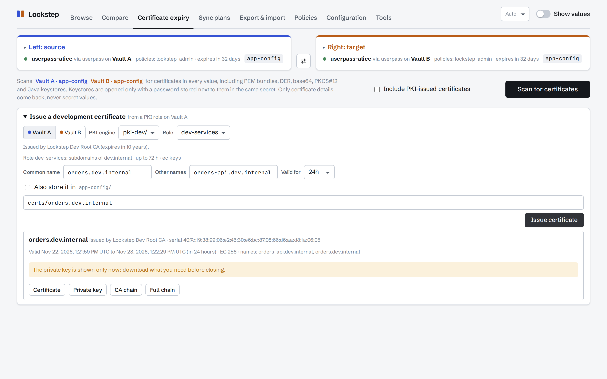
</picture>

## 6. Export and import

The **Export & import** tab moves a whole secret engine, values included, through a file: for a backup, a migration, a copy into an environment you can't reach from here, or to [compare against later](#1-choose-what-to-compare).

### Export

1. **Export from:** the left or right side's Vault, mount and prefix.
2. **Leave out** secrets (globs such as `legacy/**`) and keys (a key pattern under a path glob), or start from a comparison profile's ignore rules.
3. **Protect the file with:**
   - **A one-time key** (the default). **Export and download** saves the file and shows the key **once**: copy it, keep it apart from the file, then hide it. It's never stored, so without it the file can't be opened.
   - **A passphrase** you choose, typed twice, at least 12 characters. Share it apart from the file.
   - **age public keys** (`age1…`): pick teams the admin set up, or paste keys. Whoever holds a matching age key opens the file, in Lockstep or with the `age` tool, so no key or passphrase has to be passed around.
   - **Nothing (plain text)**, only where the admin allows plain exports. The file then holds every value in plain text, and the tool says so before you export one.

   An admin can allow only some of these (`LOCKSTEP_EXPORT_PROTECTION`, or per Vault): the others are greyed out, marked *not allowed here*. With **teams only**, the age choice reads **A team's age keys** and takes no pasted keys.

The file (`lockstep-export-<vault>-<mount>-<prefix>-<time>[.encrypted].json`) holds each secret's current data, version and update time, plus where it came from, the rules used, and what was left out or couldn't be read. Its format is described by a [JSON Schema](https://getlockstep.cloud/schemas/lockstep-export-v1.json).

**Encryption:** the envelope's header (Vault name, mount, prefix, number of secrets, time) stays readable so files can be told apart. Changing it makes the file fail to open.
- **One-time key:** AES-256-GCM with a random 256-bit key, the content zlib-compressed. The key looks like `lsk1.` followed by 43 characters.
- **Passphrase:** the same, with the key derived from the passphrase by Argon2id (64 MiB, 3 passes, 4 lanes). The salt and cost are in the header. Lockstep won't open a file that asks for more than 256 MiB.
- **age:** the `ciphertext` is a standard armored [age](https://age-encryption.org) file of the plain export, and `recipients` lists the public keys it's for. `jq -r .ciphertext file.json | age -d -i key.txt > export.json` opens it without Lockstep. age can't authenticate the readable header, so Lockstep checks it against the decrypted contents instead.

**Big mounts:** the export is written as secrets are read, a few dozen at a time, so the server never holds the whole export. A plain export streams straight to your browser; an encrypted one holds only its compressed bytes until it's sealed, and the page shows how many secrets it has read. The listing limit (`LOCKSTEP_MAX_TREE_SECRETS`) still applies. API: `POST /api/exports/stream` (NDJSON: progress lines, then the result); `POST /api/exports` returns the same in one response.

To open an encrypted file, Lockstep asks for what it needs: the key, the passphrase, or your age identity (the `AGE-SECRET-KEY-1…` line). It's sent with that one request, used in memory and never stored. If you'd rather not give Lockstep your age identity, decrypt the file with `age` and open the plain result.

Exporting reads every secret with your token, so you only export what you can read. Each export is [audit-logged](#audit-log) (`"event": "export"`: who, from where, how many secrets, whether and how it was encrypted, the age keys and teams, the rules), never with values. Exports are encrypted unless an admin allows plain ones, with `LOCKSTEP_EXPORT_MODE=any` or a preset's `export` setting. Exporting can also be turned off, for the server or for one Vault ([configuration](configuration.md)).

#### Output of `vault kv get`

Wherever Lockstep opens an export, as a comparison side or to import, it also reads `vault kv get -format=json` output (and `vault read -format=json`), for migrations from scripts that already use the `vault` CLI:
- **One file** of that output: the secret's path is the file name without `.json`.
- **A folder** of them (**Open a folder of vault kv get files…**, or `lockstep import FOLDER`): each path is the file's path in the folder.
- **One JSON object** of `{"<path>": <that output>, …}`, as a shell loop writes it:

```sh
for p in $(vault kv list -format=json secret/app | jq -r '.[]'); do
  vault kv get -format=json "secret/app/$p" | jq --arg p "$p" '{($p): .}'
done | jq -s add > app.json
```

KV v2 output keeps each secret's version and time; KV v1 output works too. A secret whose latest version is deleted or destroyed has no data, so it's listed as not exported. The opened file is then like a plain export: it holds values, nothing is kept on the server, and import rules apply.

### Import

1. **File:** open an export or `vault kv get` output (or pick one already opened in the page).
2. **Target:** the left or right side's Vault, mount and prefix. Exported paths are written under it.
3. **Rules** (optional), applied in this order:
   - **Leave out** secrets and keys, as when exporting.
   - **Transforms**, applied in order: **Replace text**, **Add prefix**, **Add suffix**, **UPPERCASE**, **lowercase**, on **values** (text values only), **key names** or **paths**. Each can be limited to paths matching a glob, and to keys matching a pattern. For example, replace `application-dev-env` with `application-test-env` in values, `devDBA` with `testDBA`, and `dev/` with `test/` in paths. A transform's path filter sees the path as earlier transforms left it.
   - **Save rules** downloads them as JSON ([schema](https://getlockstep.cloud/schemas/lockstep-import-rules-v1.json)); **Load rules** reads them back, and `lockstep import --rules` takes the same file.
4. **Delete what isn't in the file** (optional): make the target match the file. See [below](#deleting-what-isnt-in-the-file).
5. **Preview import** shows what the rules did (left out, changed) and, per target secret, the keys to add, update or remove and the version it will become, and any secrets it will delete. Secrets that two paths (or keys) would collide on are left out with the reason, never merged by guesswork.
6. Tick the confirmation and **Import**.

Importing writes like [copying](#3-copy-values-between-the-sides): values are merged into each target secret (keys only on the target are kept, nothing is deleted), with check-and-set against the version the preview saw, so a secret changed in the meantime is reported as a conflict, not overwritten. Every write is audit-logged without values, with `"source_auth": "file"`.

#### Deleting what isn't in the file

With **Make the target match the file** ticked (`lockstep import --delete-missing`), the import treats the file as the whole truth for the target's mount and prefix:
- each imported secret is written with only the file's keys, so keys only on the target are removed (the new version replaces the old one, which stays in the version history);
- secrets under the target's prefix that aren't in the file are **soft-deleted**: their latest version is deleted, and `vault kv undelete` restores it. Nothing is destroyed.

To protect a secret, list it in the file with `"keep": true` and no data. It's left exactly as it is: neither written nor deleted. Keep entries follow path transforms, like the other paths in the file:

```json
"secrets": [
  {"path": "payments/db", "version": 4, "data": {"user": "app", "password": "…"}},
  {"path": "payments/legacy-api", "keep": true}
]
```

Only what the preview listed is deleted, and only at the version the preview saw: a secret changed in the meantime is a conflict, and one created since the preview is left alone. Secrets left out by **Leave out** rules count as not in the file, so they're deleted too unless kept. Folders the token can't list are reported and nothing in them is deleted. If the target holds more secrets than Lockstep lists in one go (`LOCKSTEP_MAX_TREE_SECRETS`), the preview refuses rather than guess: import under a narrower prefix. Deleting needs the `delete` capability on `<mount>/data/…`. Every delete is audit-logged with `"action": "delete"`.

<picture>
  <source media="(prefers-color-scheme: dark)" srcset="images/17-import-dark.png">
  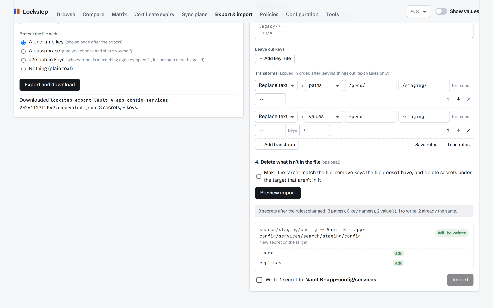
</picture>


## 7. Policies

The **Policies** tab shows what Vault ACL policies allow on every secret of a KV v2 mount, in plain terms, and which rule decides each answer. It uses the connection, mount and prefix chosen on either side. It's read-only: it reads policy texts and the names of secrets, never values, and writes nothing.

<picture>
  <source media="(prefers-color-scheme: dark)" srcset="images/18-policies-dark.png">
  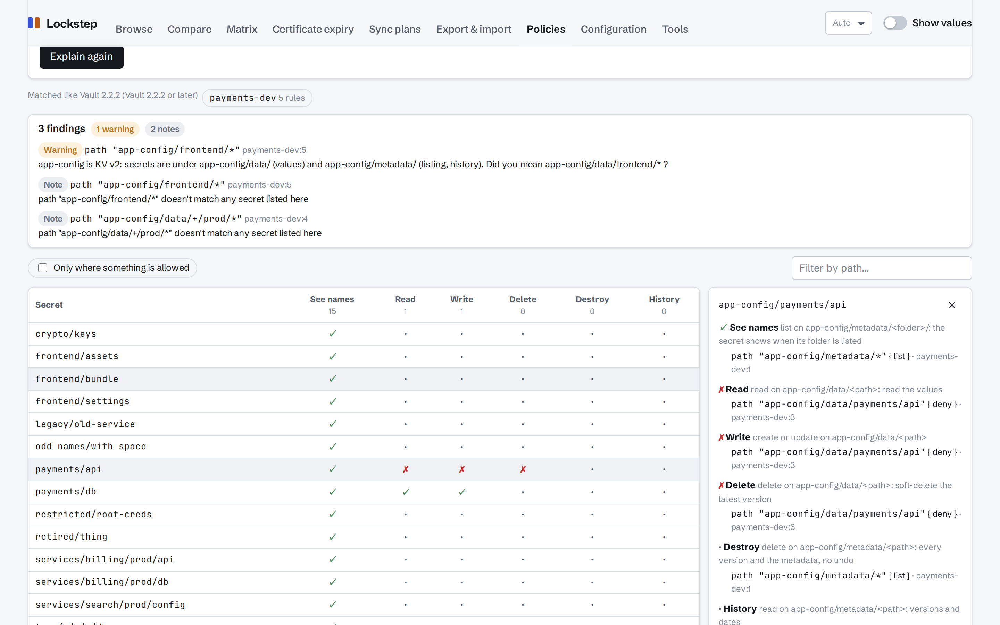
</picture>

Choose what to explain:

- **My token's policies:** everything your sign-in on that side has, including policies from identity groups. If you may not read some of them (most people can't read `sys/policies/acl/…`), Lockstep asks Vault for the answers instead (`sys/capabilities-self`). They're complete, but the rule behind each one can't be shown.
- **Policies in Vault:** pick one or more by name. If your token may not list policies, type the names.
- **Someone else:** an entity (a person or workload), an identity group, or a token (by its accessor). Lockstep gathers their policies:
  - their own;
  - those of every group they're in, including parent groups;
  - for a token, its policies plus its entity's.

  It shows where each came from. For an entity, logins also get their auth role's policies, which depend on how they sign in. Reading someone else's policies needs `read` on `identity/…` (and `update` on `auth/token/lookup-accessor` for tokens): what's missing is listed, and the answer is marked incomplete.
- **Paste a policy:** HCL or JSON, for a policy that isn't in Vault yet.

Several policies are combined the way Vault combines them: rules with the same path add up, and `deny` wins.

Each secret gets six columns. KV v2 keeps values and everything else under different paths, which is where most policy mistakes come from:

| Column | Vault needs |
|---|---|
| **See names** | `list` on `<mount>/metadata/<folder>/`: the secret shows when its folder is listed |
| **Read** | `read` on `<mount>/data/<path>` |
| **Write** | `create` or `update` on `<mount>/data/<path>` |
| **Delete** | `delete` on `<mount>/data/<path>`: soft-delete the latest version |
| **Destroy** | `delete` on `<mount>/metadata/<path>`: every version and the metadata |
| **History** | `read` on `<mount>/metadata/<path>`: versions and dates |

✓ is allowed, · is not allowed (nothing grants it), ✗ is refused by a `deny` rule. Click a secret to see, for each column, the rule that decided it, with the policy and line it came from. When several rules match a path, Vault uses the most specific one. Its rules for that are subtle: for example, `data/payments/*` beats `data/+/dev/*` for `data/payments/dev/db`, because its first wildcard comes later in the path. Lockstep follows the same rules, and its tests check every answer against Vault's own (`sys/capabilities`). Vault 2.2.2 changed some details: exact rules ignore a trailing slash, a listing considers rules for both slash forms, and `deny` rules also match whatever the case. OpenBao has rules of its own: it tries the path as written before the path without its trailing slash, and its `deny` rules match case as written. Lockstep reads which server it's talking to and its version, matches the way that server does, and the result says which rules it used. If it can't tell, it says so and assumes Vault 2.2.2 or later; **Try for real** in Build policies then asks the server itself.

**Findings** point out mistakes and risky grants:
- errors Vault would refuse, such as `+*` or an unknown capability;
- KV v2 paths without `data/` or `metadata/` (with the path you probably meant);
- `*` or `+` used where they're literal;
- `list` on `data/`, where it does nothing;
- broad grants: a whole mount, `sudo`, Vault's own configuration, destroy rights;
- rules that don't match any secret listed, or that a more specific rule always overrides.

The secrets listed are the ones *your* token can list. If it can't list some folders, they're named under **missing rights**, and their secrets aren't in the grid.

The same is available on the command line: [`lockstep policy explain`](cli.md#policies).

### Build and suggest policies

**Build & suggest** writes policies as "who can do what, where" and turns each rule into the right KV v2 paths. Nothing is written to Vault from here: you export the policies for an admin.

<picture>
  <source media="(prefers-color-scheme: dark)" srcset="images/21-policy-build-dark.png">
  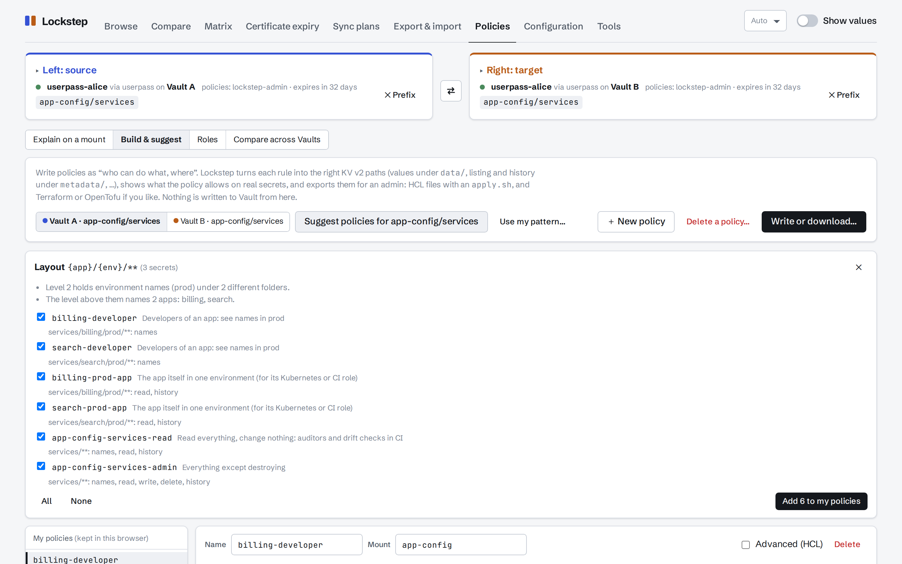
</picture>

- **＋ New policy** starts one. Each rule has a **where** and the same six choices as the Explain grid. Lockstep shows the HCL it generates, with a comment saying which rule each path came from, and findings. **Preview on** a side shows the Explain grid for the policy on that side's mount, before anyone writes it. **Advanced (HCL)** edits the text directly.

  | Where | Means |
  |---|---|
  | `payments/db` | one secret |
  | `payments/dev/**` (or `payments/dev/`) | everything under a folder |
  | `*/dev/**` | `*` is exactly one folder level |
  | `**` | the whole mount |

  *See names* on a folder lists that folder and everything below it, but not the folders above it: add rules for those if people browse from the top.
- **Suggest policies for** the side's mount and prefix looks at how the secrets are laid out. It finds a level of environment names (`dev`, `test`, `staging`, `prod`…) and the apps above it, then suggests:
  - `<app>-developer`: change dev, read test, see names in prod;
  - `<app>-<env>-app`: read one app's secrets in one environment, for its Kubernetes or CI role;
  - a read-only policy and an admin policy (everything except destroying) for the whole folder.

  It says why it chose the layout. Tick the ones you want and **Add to my policies**. They're kept in this browser.
- **Use my pattern…** describes the layout and the policies yourself, in YAML or JSON. Suggesting once fills in the detected pattern to start from. An admin can share patterns with everyone through [`LOCKSTEP_POLICY_PATTERNS`](configuration.md); **Load a shared pattern** picks one. The format is printed by `lockstep schema suggest-pattern`:

  ```yaml
  name: per app and environment
  layout: "{app}/{env}/**"            # what each level means; * = any folder
  values: {env: [dev, test, prod]}    # optional: limit or order a variable's values
  policies:
    - name: "{app}-{env}-app"         # one policy per app and environment found
      rules: [{where: "{app}/{env}/**", can: [read, history]}]
    - name: "{app}-developer"
      rules:
        - {where: "{app}/dev/**", can: [names, read, write, delete, history]}
        - {where: "{app}/prod/**", can: [names]}
  compare: {pair: {env: [dev, prod]}} # also make the policy profile for comparing dev with prod
  ```

  `{mount}` in a name is the mount and prefix. With `compare`, **Save policy profile** keeps a profile that pairs `*-dev-app` with `*-prod-app` and rewrites `/dev/` to `/prod/`, ready for **Compare across Vaults**.
- **Download for an admin…** makes a zip:
  - one `policies/<name>.hcl` per policy;
  - a README;
  - `apply.sh`, which compares each policy with Vault and shows a diff (`--dry-run` stops there), then writes the ones that changed with the `vault` CLI.

  Optionally it adds **Terraform** or **OpenTofu** files: `vault_policy` resources, the `hashicorp/vault` provider pinned to the version you pick (`~> 5.0` or `~> 4.0`), and `import` blocks for policies that already exist on the side's Vault, so they're adopted into state rather than created twice. Use either the script or Terraform for a policy, not both.

On the command line: [`lockstep policy suggest` and `lockstep policy export`](cli.md#policies).

### Roles

**Roles** shows the Kubernetes, JWT/OIDC and AppRole auth roles that decide who gets which policies when they log in.

<picture>
  <source media="(prefers-color-scheme: dark)" srcset="images/22-roles-dark.png">
  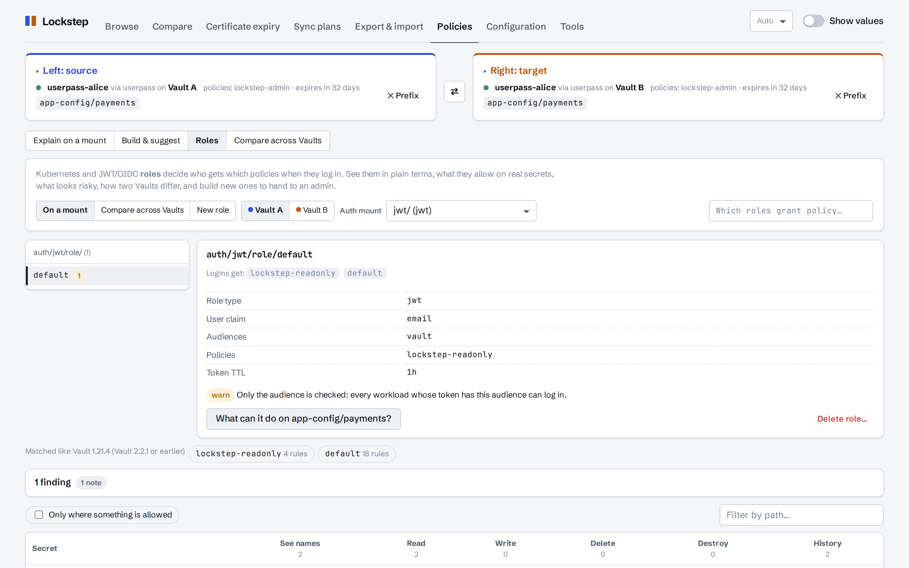
</picture>

- **On a mount:** pick an auth mount to list its roles. A role shows:
  - the policies a login gets (including `default` unless the role turns it off);
  - its settings in plain words, with defaults left out and durations readable;
  - findings:
    - a JWT role nothing ties to a workload (anyone with a token from that issuer could log in);
    - `*` for service accounts or namespaces;
    - a Kubernetes role without an audience;
    - plain-HTTP OIDC redirect URIs;
    - policies that don't exist on that Vault;
    - long-lived tokens;
    - AppRole roles without a secret ID, or whose secret IDs never expire.

  **What can it do on…** explains the role's policies together on the side's KV v2 mount, with the same grid as **Explain on a mount**.

  For an AppRole role, **Issue a secret ID…** creates one and hands it over wrapped in a one-time token, never in plain text, together with the role ID. The app or pipeline unwraps it once (`vault unwrap`) and logs in. Issuing is audit-logged with the wrapping token's accessor only.
- **Which roles grant policy…** lists every Kubernetes, JWT and OIDC role, and every identity group, that gives a policy. Entities and token roles can grant policies too, and aren't covered yet.
- **Identity groups** (in the auth mount list) shows each group's type, policies and members, and what its members can do on the side's mount. **Compare identity groups** compares two Vaults' groups: policies, type, metadata and members by name.
- **Compare across Vaults** compares the roles of an auth mount on each side, field by field, ignoring defaults. A policy profile pairs names (`*-dev` ⇄ `*-prod`) and rewrites values such as namespaces and policy names first.
- **New role** starts from a template:
  - a Kubernetes service account;
  - a GitLab CI job (`id_tokens`);
  - a GitHub Actions workflow;
  - a Kubernetes service account through JWT auth;
  - people in an identity-provider group (OIDC);
  - a CI pipeline or app with AppRole.

  You fill in a form, and the findings and the JSON update as you type. **Download for an admin…** adds your roles (and, if you like, your policies) to the same zip as policies: `roles/<mount>/<name>.json`, written by `apply.sh` after the policies, and `vault_kubernetes_auth_backend_role` / `vault_jwt_auth_backend_role` resources with `import` blocks when Terraform or OpenTofu is chosen.

Reading roles needs `list` and `read` on `auth/<mount>/role`. Nothing here writes to Vault.

### Writing policies and roles

When the server allows it (`LOCKSTEP_POLICY_APPLY`, on by default) and you may write them, Lockstep writes policies and roles itself:
- **Build & suggest → Write or download… → Write to…** writes the chosen policies.
- **Roles → New role → Write to…** writes your roles.
- **Copy to right → / ← Copy to left** in **Compare across Vaults** copies a policy to the other Vault, with the profile's rewrites applied (backwards for a copy to the left).
- **Delete a policy…** (in Build & suggest; it first shows which roles use the policy) and **Delete role…** (in Roles) delete, after you type a confirmation phrase.

Every write goes through a review:
- each item shows **new**, **change** with a diff against what's in Vault, **same**, or **delete**;
- it says whether your sign-in may do it, and warns when you change a policy your own sign-in holds.

Vault keeps no versions of policies or roles, so each item is read again just before writing and skipped as **Changed** if it moved since the review. Policies are written before the roles that use them, and deletes come last. A role is written whole: fields you left out go back to their defaults.

`root` and `default` can't be changed from Lockstep. Writes are audit-logged as `policy.write`, `policy.delete`, `role.write` and `role.delete`, with a hash of what was there before. Where Terraform owns policies, set `LOCKSTEP_POLICY_APPLY=off`: building and downloading for an admin still work.

#### Access plans

When you can't write policies or roles yourself, **Save as access plan** prepares them for someone who can. It's in **Write or download…**, beside the new-role drafts, and in the write review.
- **The file:** a signed JSON file with the policies and roles, the Vault they're for, who made it, and a hash of what was in Vault at the time. Nothing in it is secret, so it can go in a ticket.
- **Applying:** the person applying signs in to that Vault on either side and chooses **Policies → Open an access plan…**. Lockstep checks the plan was made by this server and not edited. It finds the right connection (the one with the rights, if both sides are on that Vault) and shows the same review as a write, with diffs.
- **Changes since:** anything that changed in Vault after the plan was made is shown as *Changed* and skipped.
- **Audit:** writes from a plan are logged with its `plan_id`, and making a plan is logged as `access.plan`.
- **Approvals:** where the server asks for them ([four-eyes approvals](configuration.md#four-eyes-approvals)), the review shows whether the plan is approved, and **Write** waits until someone other than its creator has opened it and chosen **Approve** (the approved file downloads). On a Vault whose preset asks for approvals, policies and roles change only through approved access plans: a direct write is shown as not allowed, with **Save as access plan** still offered.


<picture>
  <source media="(prefers-color-scheme: dark)" srcset="images/28-access-plan-dark.png">
  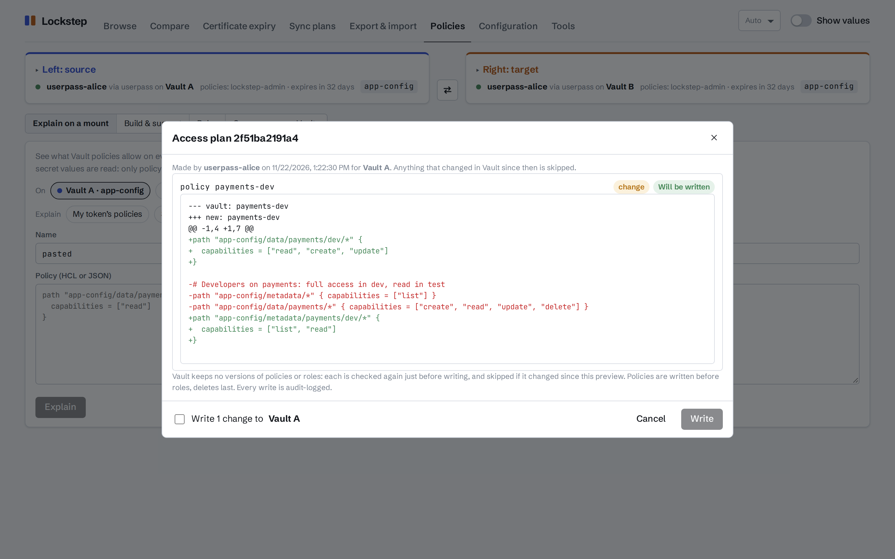
</picture>

### Compare policies across Vaults

**Compare across Vaults** compares every ACL policy on the left Vault with every one on the right. It compares by meaning: each policy is reduced to its paths and capabilities (rules with the same path added up, `deny` winning, as Vault does), so comments, whitespace, rule order and how capabilities are listed don't count. Policies that differ only that way show as *Equal* with *formatting differs*. A policy that can't be parsed is compared as text.

<picture>
  <source media="(prefers-color-scheme: dark)" srcset="images/19-policy-compare-dark.png">
  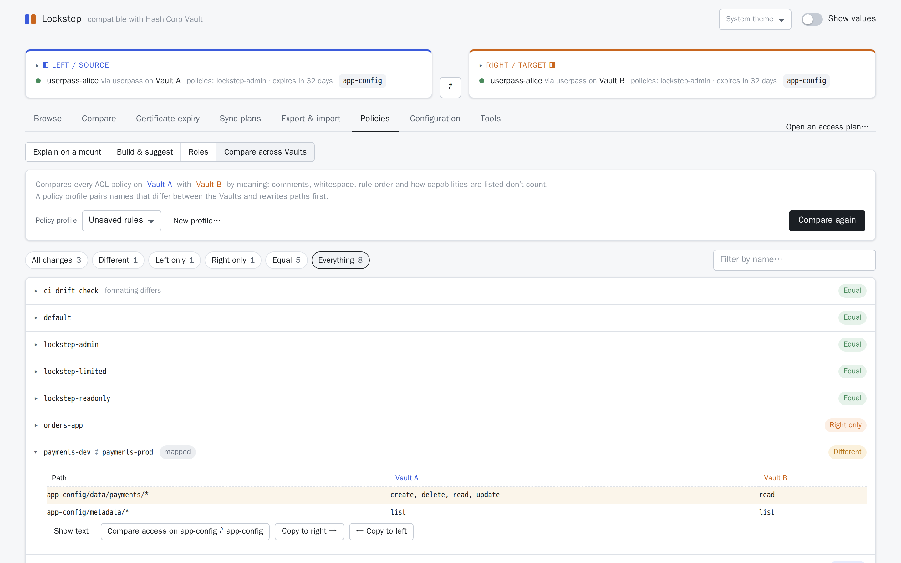
</picture>

Each policy shows as *Equal*, *Different*, *Left only*, *Right only* or *Error* (couldn't be read). Open one to see the paths whose capabilities differ, **Show text** for both texts, and **Compare access** to see what the two policies allow on the mounts chosen on each side, secret by secret: only the secrets where they differ, or all of them.

A **policy profile** lines the two Vaults up when names or paths differ between environments:

- **Pair names:** `*-dev` ⇄ `*-prod` compares `payments-dev` on the left with `payments-prod` on the right. Both sides need the same number of `*`. A paired name whose partner is missing says which name it expected.
- **Rewrite paths:** replace text in the left policies' paths before comparing, such as `/dev/` → `/prod/`, so a dev policy and its prod twin compare as equal when they grant the same thing.
- **Leave out:** names or `*` patterns, `root` by default.

**New profile…** opens the rules. Use them unsaved, or **Save to my profiles** (kept in this browser; **Export mine** and **Import…** move them as JSON). An admin can share profiles with everyone through [`LOCKSTEP_POLICY_PROFILES`](configuration.md). The format is printed by `lockstep schema policy-profile`.

Comparing needs `list` on `sys/policies/acl` and `read` on each policy, on both Vaults. What your sign-ins can't see is listed under **missing rights**. On the command line: [`lockstep policy compare`](cli.md#policies).

## 8. Configuration

The **Configuration** tab compares the two Vaults' setup, read-only:
- **Overview:** version, cluster name, seal and storage type, high availability and replication. What differs is highlighted, such as a cluster that's a version behind.
- **Secrets engines** and **auth methods:**
  - each one *Equal*, *Different*, *Left only* or *Right only*;
  - type, plugin version (built-in plugins show as `builtin`, so a version upgrade isn't drift), tuning (default and max lease TTL, listing visibility, audit settings, passthrough headers) and options such as the KV version;
  - for auth methods, their configuration (for example a JWT method's issuer and discovery URL, or a Kubernetes method's host).

  Open one to see the settings that differ. Fields that hold secrets (passwords, bind passwords, client secrets, private keys, service account tokens) are never compared, shown or copied, even if Vault returns them: they're listed by name as "not compared". Settings whose names only sound secret, such as `password_policy`, `credential_type` or GCP's `secret_type`, are compared. A field Lockstep doesn't know whose name looks secret is hidden to be safe, and marked "the name looks secret". A `false` or `0` counts as a setting, except where it's the default (a mount that isn't `local`, a TTL of `0`). Identifiers that differ on every cluster (accessors, UUIDs) are ignored. **Built-in mounts** (`sys/`, `identity/`, `cubbyhole/`, `token/`) are hidden unless you ask.
- **Engine roles and keys:** for secrets engines that both Vaults have at the same path with the same type, their roles and keys compared one by one:
  - PKI roles;
  - database connections (URL without any inline password), roles and static roles;
  - Transit key settings (not the key versions);
  - SSH, Kubernetes, AWS and Azure roles;
  - GCP rolesets, static accounts and impersonated accounts;
  - the LDAP secrets engine's dynamic roles, static roles and library sets.

  - generically, for engines Lockstep has no special handling for: TOTP keys (their settings, never the key), Consul, Nomad and RabbitMQ roles, Transform roles, transformations, templates and alphabets, and Terraform, KMIP, MongoDB Atlas, AliCloud and AD objects. For any other plugin, whatever it lists under `roles/`, `role/` or `keys/`. Each object's fields are compared, with the same handling of secret fields.

  For example, `transit/keys/app-key` is *Different* when only one side allows deletion. Values that change on their own (key versions, last rotation) are ignored. Fields only one server returns (Vault and OpenBao, or two versions, add different ones) are set aside and listed as "not compared" instead of counting as differences. Up to 200 objects are read per list, and a list that was cut off is named above the results.
- **System settings:** what lives outside the mounts, paired by name rather than by cluster-specific IDs:
  - **audit devices**, with a warning when a Vault has none (its requests aren't logged);
  - **password policies** (their rules, compared line by line), **token roles**, and **rate-limit and lease-count quotas** with the quota settings;
  - **MFA methods**, by their name, and **login enforcements**, with the methods, auth methods, groups and entities they name;
  - **registered plugins** (not built-in ones), with each version's SHA-256;
  - **identity entities** that carry configuration: their policies, metadata and aliases (`userpass/alice`). An entity Vault created at sign-in is paired by its aliases, and one with no policies or metadata is left out: it's just someone who signed in. Identity groups are compared in **Policies**.

  Reading them needs `sudo` on `sys/audit` and `sys/plugins/catalog` and `read` on the rest. What a sign-in can't read is listed under **missing rights**.

**Copy to the other side:** open a row that differs and use **Copy tuning to …** (a mount's or auth method's TTLs, description, listing visibility and audit and header settings) or, for an engine role, **Copy to …**. It goes through the same review as policies (a diff against what's there, a conflict check, audit) and can be saved as an access plan for someone else to apply. What's copied:
- roles of PKI, database (dynamic roles), SSH, Kubernetes, AWS, Azure and the LDAP secrets engine (dynamic roles), whole;
- Transit keys' `deletion_allowed` and `auto_rotate_period`, for a key that exists on both sides.

Not copied: database connections and static roles, GCP rolesets and accounts, LDAP static roles and library sets (they hold or rotate credentials, or create cloud accounts), plugin versions and KV options. It needs `LOCKSTEP_POLICY_APPLY` on.

**Configuration profiles** line up Vaults that name things differently. A profile:
- pairs mounts by pattern (`kv-dev => kv-prod`, `kubernetes-* => k8s-*`), and a mount's roles and keys follow it;
- rewrites the left side's values first (`dev.example.com => prod.example.com`);
- leaves paths out (`sandbox-*`).

Write one with **New profile…**, which keeps it in this browser, or share them from the server with `LOCKSTEP_CONFIG_PROFILES` (chart value `configProfiles`). Paired rows show both paths (`kv-dev/ ⇄ kv-prod/`).

It needs `read` on `sys/mounts` and `sys/auth` (and on `auth/<path>/config` for the configuration, and `list`/`read` on the engines' roles and keys). Without them, Lockstep uses the mount list your token can see and says what's missing. In CI: [`lockstep config compare`](cli.md#configuration).

<picture>
  <source media="(prefers-color-scheme: dark)" srcset="images/23-config-dark.png">
  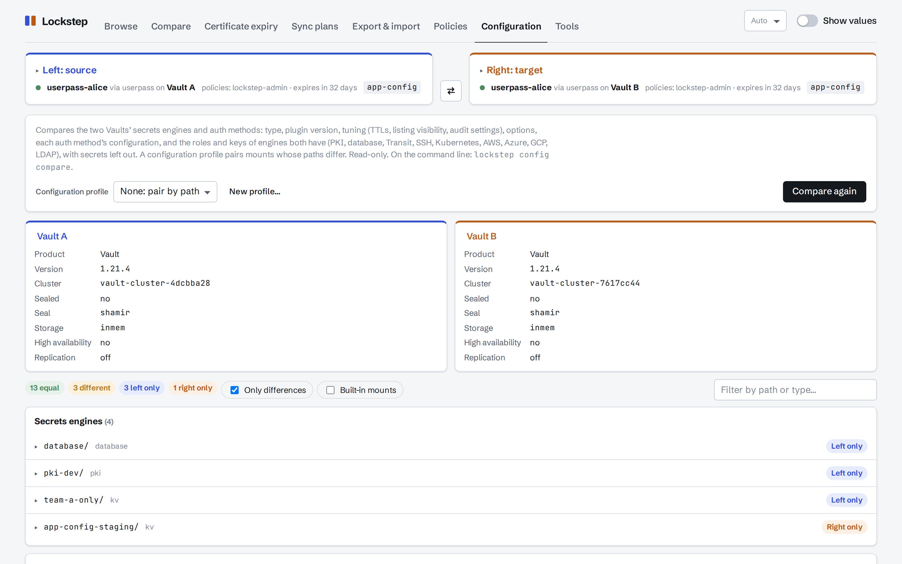
</picture>

## 9. Tools

The **Tools** tab has a **Transit playground** for building an integration with Vault's Transit secrets engine:
- **Keys:** pick a key to see its type and versions (no key material).
- **Operations:** encrypt, decrypt, rewrap to the latest key version, sign, verify or HMAC, using your own sign-in.
- **Chaining:** **Decrypt it** and **Verify it** feed the result straight back in.

Lockstep stores nothing; Vault's audit log records the operations. The dev stack has `transit/` with `app-key` (AES-256-GCM) and `signing-key` (Ed25519) on both Vaults.


<picture>
  <source media="(prefers-color-scheme: dark)" srcset="images/24-transit-dark.png">
  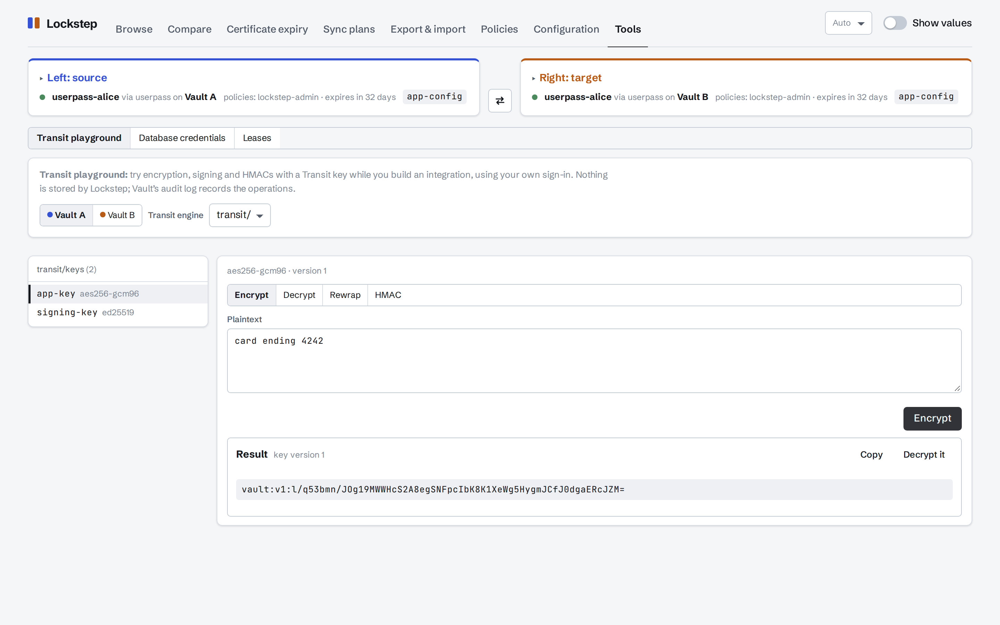
</picture>

### Database credentials

**Tools → Database credentials** shows a database secrets engine's setup and generates credentials:
- **Read-only:** its connections (plugin, connection URL with any inline password hidden, the account Vault uses, allowed roles), its dynamic roles (database, TTLs, creation SQL) and its static roles.
- **Generate credentials:** for a dynamic role, with your own sign-in. The password stays masked until you choose **Show**. **Revoke now** ends them when you're done.

Generating is audit-logged with the lease ID, never the password, and is refused when the server is read-only. Configuring connections and roles, and rotating root, stays in the Vault UI or Terraform. The dev stack has `database/` on Vault A, connected to a PostgreSQL container, with the roles `orders-readonly` and `orders-app`.


<picture>
  <source media="(prefers-color-scheme: dark)" srcset="images/25-database-dark.png">
  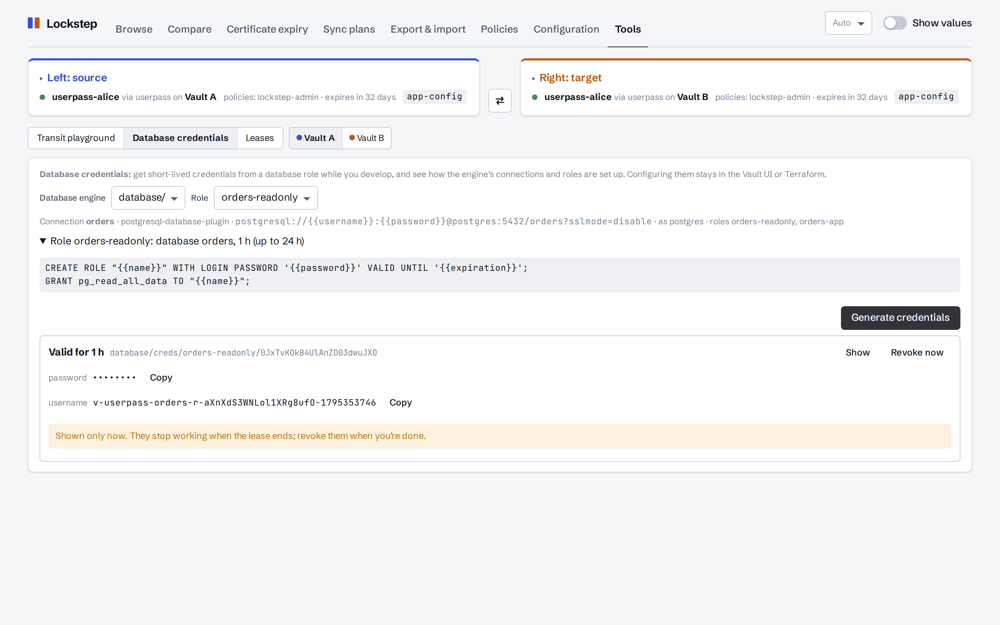
</picture>

### Leases

**Tools → Leases** browses the leases Vault has handed out (dynamic credentials, tokens) by path, like Vault's own lease tree:
- **What it shows:** when each lease was issued and when it expires, and whether it's renewable.
- **Renew:** renews a lease.
- **Revoke:** revokes the selected leases one by one (never by prefix), after you type `revoke N leases`.

Listing needs `sudo` on `sys/leases/lookup/*`. The `default` policy's exact rule on `sys/leases/lookup` hides the top level even from tokens with sudo below it, so Lockstep then lists mount by mount. Renew and revoke are audit-logged, and refused when the server is read-only.


<picture>
  <source media="(prefers-color-scheme: dark)" srcset="images/26-leases-dark.png">
  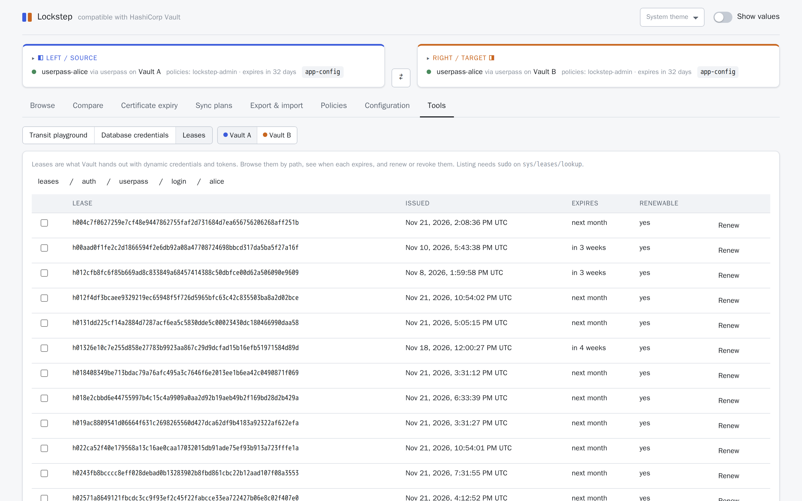
</picture>

