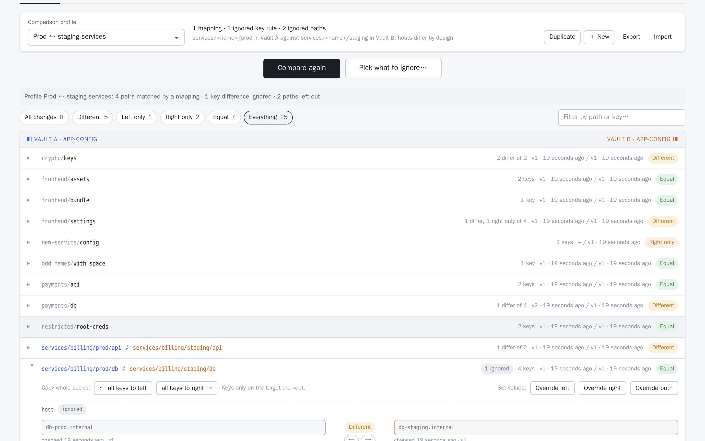
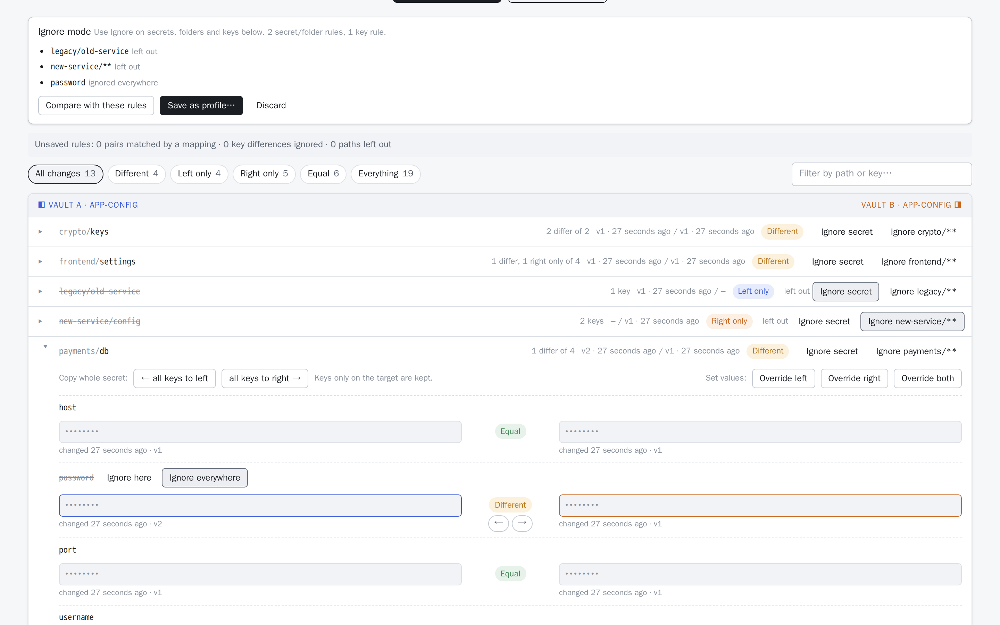
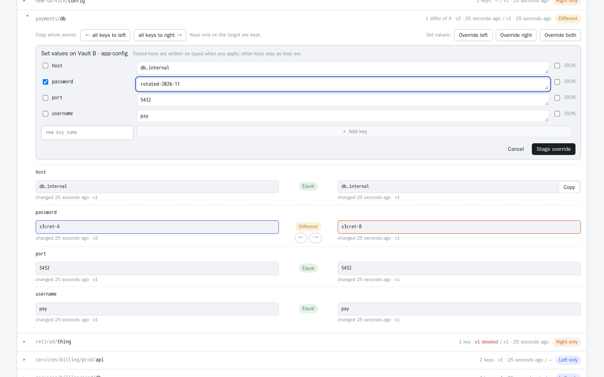
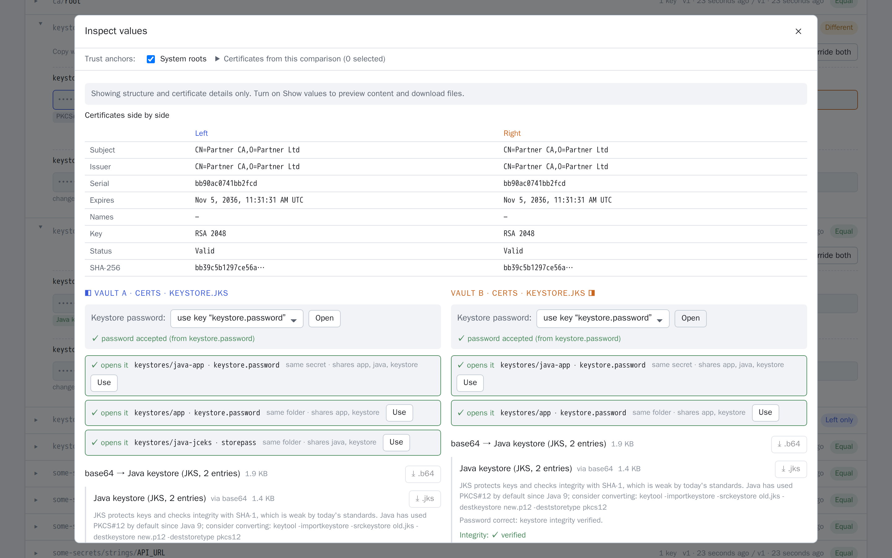
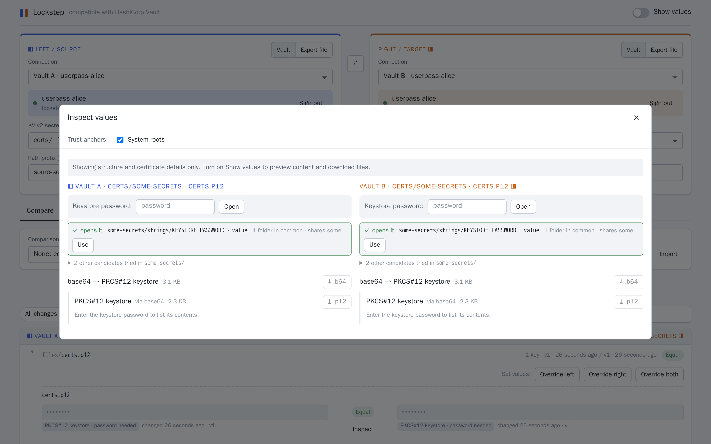
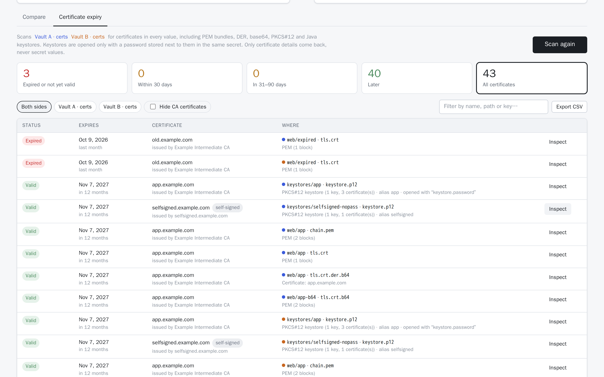
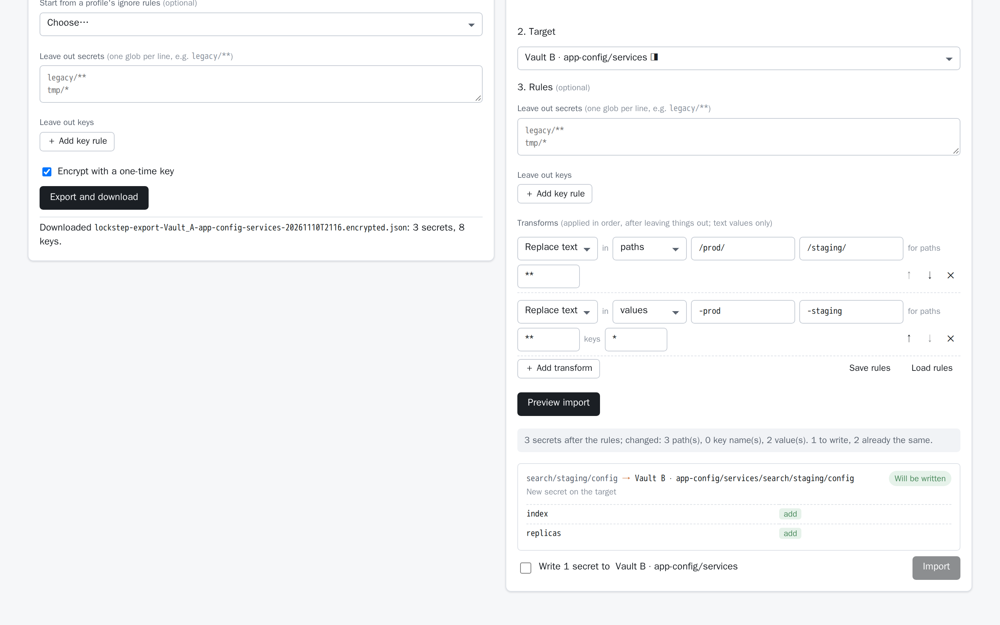

<!-- description: How to use Lockstep: compare Vault KV v2 locations or an export, profiles, copying and overriding values, sync plans, value tools, certificate expiry, export and import. -->
# Using the tool

## 1. Choose what to compare

Each side (left in blue, right in orange) needs:

- **a connection:** a Vault and a sign-in. See [authentication](authentication.md).
- **a KV v2 secrets engine.** Mounts are listed from `sys/mounts`. If the token can't read that, the list comes from what the token can access, and you're told it may be incomplete. You can always type a mount path, which is checked before use. KV v1 mounts are not offered.
- **an optional path prefix.** Paths are compared relative to each side's prefix, so `app-config/payments` can be compared with `app-config-staging/payments`.

Both sides can be the same Vault with different mounts or prefixes. ⇄ swaps the sides.

**Or an export file.** Switch a side from **Vault** to **Export file** and open a [secret-engine export](#6-export-and-import) (with its key if it's encrypted) to compare a Vault against it: a backup, or another environment's export. *Show values* reads the file's values in the page. An export is read-only: you can copy values **from** it into a Vault, never into it, and it has no version history or value inspector. It's held in the page's memory only and is gone when you reload.

## 2. Read the comparison

Press **Compare**. The server lists both trees, reads every secret on both sides, compares them, and returns **only statuses**: no values. They're dropped as soon as each secret has been compared.

| Status | Meaning |
|---|---|
| **Equal** | Same keys, same values |
| **Different** | At least one key differs, or exists on one side only |
| **Left only / Right only** | The secret exists on one side only (a soft-deleted latest version counts as absent, shown as *deleted*) |
| **No access** | One side can't list or read it. Its keys show as *unknown*, never as "only on the other side", so nobody copies over data they couldn't see |
| **Error** | Vault returned something else; the message is shown |

What counts as a difference:

- Only **values** count. Versions, timestamps and metadata are shown but ignored.
- Values are compared as canonical JSON: key order inside nested JSON doesn't matter.
- `5432` (a number) and `"5432"` (a string) are different. The row says **type differs: number vs string**, and values are shown with their types.

Filters (*All changes*, *Different*, *Left only*…, *Everything*) and the path/key search narrow the list. Folders a side couldn't list are named above the results.

### Values and metadata

- **Show values** (top right) reveals values, only for secrets you expand. They're fetched on demand and forgotten when you switch it off.
- Each secret's header shows each side's **current version and when it was written**. Under every value is **when that key last changed** (`changed 3 days ago · v2`). Vault only timestamps whole versions, so the tool works this out by walking back through the versions. `≥` means the history was cut short (deleted, destroyed or trimmed versions). None of this affects the comparison.
- A **badge** under each value says what it is (`PKCS#12 keystore · password needed`, `PEM · expired`…), even while values are masked. See [value tools](#4-value-tools).

## Comparison profiles

A profile tells Lockstep how the two sides relate, when they aren't laid out identically. Choose one in the **Comparison profile** bar, then compare.

<picture>
  <source media="(prefers-color-scheme: dark)" srcset="images/09-profile-dark.png">
  
</picture>

| Rule | Example | Effect |
|---|---|---|
| **Path mapping** | `services/*/prod/**` ⇄ `services/*/staging/**` | Pairs `services/billing/prod/db` (left) with `services/billing/staging/db` (right). The row shows both paths |
| **Ignored key** | `host` under `services/**` | `host` is still shown, marked *ignored*, but its difference doesn't make the secret **Different** |
| **Ignored path** | `legacy/**` | Matching secrets are left out of the comparison |

How the rules work:
- **Patterns:** `*` matches within one path segment and `**` across any depth. Both sides of a mapping need the same wildcards in the same order, and what they match is carried across. The first matching mapping wins. Paths no mapping matches are compared as they are.
- **Copies follow the mapping.** Copying a left-only `services/search/prod/config` to the right writes `services/search/staging/config`.
- **Collisions are refused, not guessed.** If two left paths map onto the same right path, that pair shows as an **Error** explaining which paths collide.
- **Mounts too:** a profile can also remember each side's mount and prefix, applied when you pick it.
- **The summary line** says how many pairs a mapping matched, and how many key differences and paths the profile ignored.

**Shared and personal profiles:**
- *Shared* profiles come from the server (`LOCKSTEP_PROFILES`, see [configuration](configuration.md)), so a team sees the same rules. They're read-only: **Duplicate** makes an editable copy.
- *Personal* profiles are saved in your browser. **New** and **Edit** open the editor; **Export** and **Import** move them between browsers or people as JSON.

### Building a profile from a comparison

You don't need to write patterns to ignore things. Compare, then press **Pick what to ignore…**:

- **On a secret:** **Ignore secret** leaves that secret out; **Ignore *folder*/\*\*** leaves out everything in its folder.
- **On a key** (in an expanded secret, for keys that differ): **Ignore here** ignores that key's differences in this secret only; **Ignore everywhere** ignores it in every secret.

Each pick is struck through straight away and listed in the bar above the results. Pressing it again undoes it. **Compare with these rules** runs the comparison with your picks on top of the selected profile, so you can check the effect before keeping them. **Save as profile…** opens the profile editor with the rules filled in: name it and save. If a personal profile is selected, the button reads **Add to “*name*”…** and adds the picks to it. With a shared profile, it saves a copy. Unsaved picks are kept until you save or **Discard** them.

<picture>
  <source media="(prefers-color-scheme: dark)" srcset="images/15-pick-ignore-dark.png">
  
</picture>

## 3. Copy values between the sides

- **← / →** next to a key stages a copy of that key toward that side. A key can only travel one way.
- **all keys to left / right**, inside an expanded secret, stages every key the source has.
- A dashed outline marks each value that will be overwritten. The bar at the bottom counts what's staged.

### Override values

To set a value yourself instead of copying the other side's, expand the secret and choose **Override left**, **Override right** or **Override both**. Tick the keys to set and type their new values; **＋ Add key** adds a key the secret doesn't have yet. Values are text unless you tick **JSON**, which stores numbers, booleans, objects and lists as those types. While *Show values* is off, what you type is masked; with it on, the fields start from the side's current values.

<picture>
  <source media="(prefers-color-scheme: dark)" srcset="images/13-override-dark.png">
  
</picture>

**Stage override** adds the values to the changeset, marked **set →** or **← set** on each key, and they go through the same review and apply as copies: check-and-set against the version you compared, other keys kept, nothing deleted. An override and copies into the same secret are written together, as one new version. A key is either copied or overridden on a side, not both: staging one replaces the other.

Override values are the only values the browser sends to the server. They're kept in the page until you apply or clear them, are never stored, and aren't audit-logged: the log lists the overridden key names only. Because [sync plans](#sync-plans) never hold values, a review with overrides can't be saved as a plan.

**Review & apply** opens a preview for each target secret: keys **added** or **updated** (with old → new values if *Show values* is on), the version it will become, and any problems:

| Preview status | Meaning |
|---|---|
| Will be written | Ready |
| Already the same | Nothing to do |
| Changed since compare | The target's version moved since you compared. Compare again |
| No permission | The target token can't write there (`sys/capabilities-self`) |
| Can't copy | The source no longer has that key or data |

Tick the confirmation (it names the target Vaults and mounts) and **Apply**. Then:

- **Fresh source values:** copied values are **read again from Vault**, never taken from the browser. The only values the browser sends are the ones you typed as overrides.
- **Check-and-set:** each write uses KV v2 **check-and-set** against the version you saw. If someone else changes the target in the meantime, that secret comes back as **Conflict: not written**; the rest still go through.
- **No deletes:** keys that exist only on the target are kept. Nothing is ever deleted.
- **Types preserved:** a number stays a number.

Results are shown for each secret, then the tool compares again.

### Audit log

Every attempted write, applied or not, produces one JSON line on the server's stdout:

```json
{"event": "sync.apply", "outcome": "applied", "ts": "2026-11-08T12:00:00Z",
 "actor": {"source_identity": "oidc-alice@example.com", "source_auth": "oidc",
           "target_identity": "oidc-alice@example.com", "target_auth": "oidc"},
 "source": {"vault": "Vault B", "url": "http://vault-b:8200", "mount": "app-config", "path": "frontend/settings", "version": 8},
 "target": {"vault": "Vault A", "url": "http://vault-a:8200", "mount": "app-config", "path": "frontend/settings",
            "old_version": 8, "new_version": 9},
 "keys": ["cdn_url"], "overridden": [], "message": ""}
```

Values are never logged: `keys` lists every key written and `overridden` the ones set from typed values. Outcomes are `applied`, `conflict`, `denied`, `invalid` and `error`.

### Sync plans

A plan is a reviewed set of copies saved as a file, so one person can prepare the changes and
another (with write access to the targets) can apply them later. It's also a report of what
needs updating from where.

**Save a plan.** Stage copies as usual and open **Review & apply…**. Add an optional note and
choose **Save as plan**. You don't need write access to the targets to do this: a read-only
user can prepare a plan for someone else. Lockstep downloads `lockstep-plan-<date>-<id>.json`;
**Download report** gives the same plan as a Markdown table (from, to, key, add or update).
Changes that conflict or can't be read can't go into a plan: compare again first. Keys whose
target already has the same value are left out.

A plan records, for each secret: the source and target paths, the keys and whether each is
added or updated, and the version of the source and target at the time. It **never contains
values**: they're read from the source when the plan is applied. It also records who created
it on each side, the comparison profile (if any) and the note. The file is signed by the
Lockstep server (with a key derived from `LOCKSTEP_SESSION_KEY`), so any edit to it is
detected and the plan is refused. A plan made by one Lockstep server can't be applied on
another with a different session key, and changing the session key invalidates existing plans.

**Apply a plan.** Connect both sides to the Vaults the plan names (any identity with write
access to the targets), open the **Sync plans** tab and choose **Open a plan file…**. Check
the report, then **Check plan**: Lockstep reads every source and target now.

- If every secret is exactly as it was when the plan was made, tick the confirmation and
  choose **Apply plan**. Each write uses check-and-set and is audit-logged with the plan's ID
  (`"plan_id"` in the `sync.apply` event).
- If **any** source or target has changed since then, the whole plan is refused and nothing
  is written. The person applying it is told to ask for a new plan, made from a fresh
  comparison.
- If you lack write access to any target, nothing is written either.

The check runs again when you apply. If a secret changes in the moment between that check and
its write, that one write is refused (check-and-set) and the result says so.

## 4. Value tools

**Inspect** (under the status of a key with a badge) opens that key's value from one or both sides. The value is identified by **content, not by key name**, through as many layers as it has: base64 → PEM → certificates, base64 → DER, and so on.

| Detected | What you get |
|---|---|
| X.509 certificate, PEM bundle, PKCS#7, DER | Subject, issuer, names (SANs), validity, key usage, key type, serial, fingerprints. **Chain validation** link by link: signature, issuer is a CA, dates. The verdict is *trusted*, *untrusted root*, *incomplete* or *invalid* |
| PKCS#12 | Opens with a typed password, one taken from another key in the same secret (keys named like `*pass*` are suggested), or one the [password finder](#finding-a-keystore-password) locates elsewhere. Lists the private key and certificates, and checks the key matches its certificate |
| JKS / JCEKS | Certificates are listed without a password. With it, the keystore's integrity is verified and JKS private keys are decrypted and matched to certificates. JCEKS private keys are shown as present only |
| Private key, encrypted key, public key, CSR | Type and size; which certificate (in this value or elsewhere in the secret) the key belongs to |
| PNG, JPEG, GIF, WebP, ICO, SVG | Preview. SVGs are shown as images, so scripts inside them never run |
| ZIP / JAR, GZIP, PDF, other binary | File list (ZIP), hex preview, download |

<picture>
  <source media="(prefers-color-scheme: dark)" srcset="images/08-inspect-jks-dark.png">
  
</picture>

**Chains.** Intermediates are taken from the value itself and from the secret's other keys (`chain.pem`, `ca.crt`…). Trust anchors are the **system roots** (Mozilla's list), any certificate key from the comparison you tick, or **Trust this root**, offered for a self-signed root found alongside the value. Anchor choices apply to that inspection only and aren't saved.

**Both sides.** When a key exists on both sides, Inspect opens them in two columns and compares their first certificates field by field. For example, a renewed certificate shows the same subject and a new serial and expiry.

**Previews and downloads** need *Show values*. Private keys inside keystores can't be downloaded. Keystore passwords are used for that one request only.

### Finding a keystore password

Keystore passwords often live away from the keystore, for example `some-secrets/files/certs.p12` with its password in `some-secrets/strings/KEYSTORE_PASSWORD`. When the inspector opens a locked keystore, it looks for the password straight away:

<picture>
  <source media="(prefers-color-scheme: dark)" srcset="images/14-password-finder-dark.png">
  
</picture>

1. It searches the keystore's **top-level folder** (`some-secrets/` here; the whole mount for a secret at the root), up to 500 secrets.
2. **Candidates** are short, single-line values whose key name or secret name looks like a password (`*pass*`, `*pwd*`, `*pin*`, `*secret*`), or that sit in a folder named like one (`passwords/`, `creds/`…).
3. They're **ranked** by closeness (same secret first, then the most folders in common) and by shared name words, so `CERT_PASSWORD` ranks high for `certs.p12`.
4. The server **tries** the 40 best against the keystore. Ones that open it are listed first with **Use**; the others are listed as tried. If none does, Java's default password (`changeit`) is tried too.

Only where each candidate is (path and key) and whether it opens the keystore come back, never the values, and nothing is written. You need read access to the secrets searched; folders you can't list are skipped.

## 5. Certificate expiry

The **Certificate expiry** tab scans the mounts (and prefixes) chosen on one or both sides for **every certificate stored anywhere**: PEM certificates and bundles, DER, base64-wrapped forms, PKCS#12 files, and JKS/JCEKS keystores. All are found by content, not key name.

<picture>
  <source media="(prefers-color-scheme: dark)" srcset="images/11-expiry-dark.png">
  
</picture>

- **Tiles** split the certificates into expired or not yet valid, within 30 days, in 31–90 days, and later. Each certificate is in exactly one tile. Click a tile to show just that group.
- **Each row** shows the certificate (subject, issuer, CA or self-signed), when it expires, and where it lives: side, path, key, the container (e.g. *PKCS#12 keystore*, alias) and, for keystores, which key's password opened it.
- **Filter and export:** filter by side, hide CA certificates, search, and **Export CSV** what's shown.
- **Inspect** opens the value in the [value tools](#4-value-tools).

Keystores that need a password are opened with a password stored in the same secret (keys named like `*pass*`, `*pwd*`), or else with the 10 best candidates the [password finder](#finding-a-keystore-password) ranks from the keystore's top-level folder within the scanned tree: keys you can already read. The row says which key opened it. Keystores that can't be fully checked are listed under *not fully checked*, never silently skipped. Only certificate details come back from the server, never secret values.

## 6. Export and import

The **Export & import** tab moves a whole secret engine, values included, through a file: for a backup, a migration, a copy into an environment you can't reach from here, or to [compare against later](#1-choose-what-to-compare).

### Export

1. **Export from:** the left or right side's Vault, mount and prefix.
2. **Leave out** secrets (globs such as `legacy/**`) and keys (a key pattern under a path glob), or start from a comparison profile's ignore rules.
3. **Encrypt with a one-time key** is on by default. **Export and download** saves the file and shows the key **once**: copy it, keep it apart from the file, then hide it. It's never stored, so without it the file can't be opened. Unencrypted exports hold every value in plain text, and the tool says so before you export one.

The file (`lockstep-export-<vault>-<mount>-<prefix>-<time>[.encrypted].json`) holds each secret's current data, version and update time, plus where it came from, the rules used, and what was left out or couldn't be read. Its format is described by a [JSON Schema](https://getlockstep.cloud/schemas/lockstep-export-v1.json).

**Encryption:** AES-256-GCM with a random 256-bit key, the content zlib-compressed. The key looks like `lsk1.` followed by 43 characters. The envelope's header (Vault name, mount, prefix, number of secrets, time) stays readable so files can be told apart, and is authenticated: changing it makes the file fail to open.

Exporting reads every secret with your token, so you only export what you can read. Each export is [audit-logged](#audit-log) (`"event": "export"`: who, from where, how many secrets, whether encrypted, the rules), never with values. Admins can allow only encrypted exports, or turn exporting off, with `LOCKSTEP_EXPORT_MODE` ([configuration](configuration.md)).

### Import

1. **File:** open an export (or pick one already opened in the page).
2. **Target:** the left or right side's Vault, mount and prefix. Exported paths are written under it.
3. **Rules** (optional), applied in this order:
   - **Leave out** secrets and keys, as when exporting.
   - **Transforms**, applied in order: **Replace text**, **Add prefix**, **Add suffix**, **UPPERCASE**, **lowercase**, on **values** (text values only), **key names** or **paths**. Each can be limited to paths matching a glob, and to keys matching a pattern. For example, replace `application-dev-env` with `application-test-env` in values, `devDBA` with `testDBA`, and `dev/` with `test/` in paths. A transform's path filter sees the path as earlier transforms left it.
   - **Save rules** downloads them as JSON ([schema](https://getlockstep.cloud/schemas/lockstep-import-rules-v1.json)); **Load rules** reads them back, and `lockstep import --rules` takes the same file.
4. **Delete what isn't in the file** (optional): make the target match the file. See [below](#deleting-what-isnt-in-the-file).
5. **Preview import** shows what the rules did (left out, changed) and, per target secret, the keys to add, update or remove and the version it will become, and any secrets it will delete. Secrets that two paths (or keys) would collide on are left out with the reason, never merged by guesswork.
6. Tick the confirmation and **Import**.

Importing writes like [copying](#3-copy-values-between-the-sides): values are merged into each target secret (keys only on the target are kept, nothing is deleted), with check-and-set against the version the preview saw, so a secret changed in the meantime is reported as a conflict, not overwritten. Every write is audit-logged without values, with `"source_auth": "file"`.

#### Deleting what isn't in the file

With **Make the target match the file** ticked (`lockstep import --delete-missing`), the import treats the file as the whole truth for the target's mount and prefix:
- each imported secret is written with only the file's keys, so keys only on the target are removed (the new version replaces the old one, which stays in the version history);
- secrets under the target's prefix that aren't in the file are **soft-deleted**: their latest version is deleted, and `vault kv undelete` restores it. Nothing is destroyed.

To protect a secret, list it in the file with `"keep": true` and no data. It's left exactly as it is: neither written nor deleted. Keep entries follow path transforms, like the other paths in the file:

```json
"secrets": [
  {"path": "payments/db", "version": 4, "data": {"user": "app", "password": "…"}},
  {"path": "payments/legacy-api", "keep": true}
]
```

Only what the preview listed is deleted, and only at the version the preview saw: a secret changed in the meantime is a conflict, and one created since the preview is left alone. Secrets left out by **Leave out** rules count as not in the file, so they're deleted too unless kept. Folders the token can't list are reported and nothing in them is deleted. If the target holds more secrets than Lockstep lists in one go (`LOCKSTEP_MAX_TREE_SECRETS`), the preview refuses rather than guess: import under a narrower prefix. Deleting needs the `delete` capability on `<mount>/data/…`. Every delete is audit-logged with `"action": "delete"`.

<picture>
  <source media="(prefers-color-scheme: dark)" srcset="images/17-import-dark.png">
  
</picture>

